# AI Agents Masterclass roadmap

## Philosophy

Learn AI agents like a Staff or Principal Backend Engineer: start with the underlying model, add capabilities deliberately, measure behavior, and finish with production architecture rather than a demo-only agent loop.

## Curriculum

| Module | Topic | Outcome | Status |
| --- | --- | --- | --- |
| 1 | LLM fundamentals | Explain tokens, embeddings, attention, Transformers, and hallucinations | Complete |
| 2 | Prompt engineering and in-context learning | Design and evaluate reliable instruction interfaces | Complete |
| 3 | Tool calling | Build constrained, validated model-to-software interfaces | Draft |
| 4 | Retrieval-augmented generation | Ground responses in private and changing knowledge | Draft |
| 5 | Memory | Separate conversational, semantic, and operational state | Draft |
| 6 | Planning | Compare ReAct and plan-and-execute patterns | Draft |
| 7 | Single-agent systems | Implement a bounded observe-decide-act loop | Draft |
| 8 | Multi-agent systems | Identify when specialization offsets coordination cost | Draft |
| 9 | Production architecture | Add reliability, evaluation, observability, security, and cost controls | Draft |
| 10 | Model Context Protocol | Connect agents to tools and context through a standard protocol | Planned |
| 11 | Build an agent framework | Implement the core abstractions without hiding the mechanics | Planned |
| 12 | Capstone project | Design, ship, and evaluate a production-grade agent system | Planned |

Status meanings: **Complete** chapters have been reviewed with the learner and have a learning journal; **Draft** chapters are written and referenced but not yet reviewed; **Planned** modules have no chapter yet.

## Chapters by module

| Module | Chapters |
| --- | --- |
| 1 | [LLM fundamentals](docs/foundations/llm-fundamentals.md), [sampling and structured output](docs/foundations/sampling-and-structured-output.md), [latency, cost, and rate limits](docs/foundations/latency-cost-and-rate-limits.md), [failure modes and nondeterminism](docs/foundations/failure-modes-and-nondeterminism.md) |
| 2 | [Prompt engineering](docs/prompting/prompt-engineering.md) |
| 3 | [Tool calling](docs/tool-calling/tool-calling.md) |
| 4 | [Retrieval-augmented generation](docs/rag/retrieval-augmented-generation.md), [ingestion and chunking](docs/rag/ingestion-and-chunking.md), [retrieval and ranking](docs/rag/retrieval-and-ranking.md), [grounding and evaluation](docs/rag/grounding-and-evaluation.md), [multi-tenant RAG](docs/rag/multi-tenant-rag.md) |
| 5 | [Context engineering](docs/memory/context-engineering.md), [durable memory](docs/memory/durable-memory.md), [checkpointing and recovery](docs/memory/checkpointing-and-recovery.md) |
| 6 | [Planning](docs/planning/planning.md) |
| 7 | [Agents and tool use](docs/agents/agents-and-tool-use.md) |
| 8 | [Multi-agent systems](docs/agents/multi-agent-systems.md) |
| 9 | [Evaluation](docs/production/evaluation.md), [observability](docs/production/observability.md), [reliability](docs/production/reliability.md), [security and privacy](docs/production/security.md), [cost and routing](docs/production/cost-and-routing.md), [human approval](docs/production/human-approval.md), [production readiness review](docs/production/production-readiness-review.md) |

## Learning progression

```mermaid
flowchart LR
    A["LLM fundamentals"] --> B["Prompts"]
    B --> C["Tool calling"]
    C --> D["RAG and memory"]
    D --> E["Planning"]
    E --> F["Single agent"]
    F --> G["Multi-agent"]
    G --> H["Production architecture"]
    H --> I["MCP"]
    I --> J["Agent framework"]
    J --> K["Capstone"]
```

## Repository milestones

- **Foundation:** repository conventions, templates, documentation site, and Module 1.
- **Capability examples:** one runnable example for tokens, embeddings, attention, tool calling, RAG, and planning.
- **Progressive projects:** chatbot, RAG chat, single agent, multi-agent system, and production agent.
- **Production readiness:** automated evaluation, traces, security review, deployment guidance, and incident playbooks.

## How to study each module

1. Read the chapters end to end once.
2. Build the exercises; reading alone does not stick.
3. Answer the interview questions aloud before opening the model answers.
4. Revisit the questions a week later, and record corrections in the module's learning journal.

## Suggested six-week plan

| Week | Work |
| --- | --- |
| 1 | Module 1. Call a model API directly and measure tokens, latency, and cost |
| 2 | Modules 2–3. Rewrite a prompt as an interface contract; build validated tools |
| 3 | Module 4. Build a small RAG over your own notes with hybrid search and a golden set |
| 4 | Modules 6–7. Write an agent loop without a framework, then rebuild it as a graph |
| 5 | Module 5. Add checkpointing and idempotent side effects to the agent |
| 6 | Modules 8–9. Add tracing, an offline evaluation suite, prompt-injection tests, and an approval gate |
