# AI Agents Masterclass roadmap

## Philosophy

Learn AI agents like a Staff or Principal Backend Engineer: start with the underlying model, add capabilities deliberately, measure behavior, and finish with production architecture rather than a demo-only agent loop.

## Curriculum

| Module | Topic | Outcome | Status |
| --- | --- | --- | --- |
| 1 | LLM fundamentals | Explain tokens, embeddings, attention, Transformers, and hallucinations | Complete |
| 2 | Prompt engineering and in-context learning | Design and evaluate reliable instruction interfaces | Next |
| 3 | Tool calling | Build constrained, validated model-to-software interfaces | Planned |
| 4 | Retrieval-augmented generation | Ground responses in private and changing knowledge | Planned |
| 5 | Memory | Separate conversational, semantic, and operational state | Planned |
| 6 | Planning | Compare ReAct and plan-and-execute patterns | Planned |
| 7 | Single-agent systems | Implement a bounded observe-decide-act loop | Planned |
| 8 | Multi-agent systems | Identify when specialization offsets coordination cost | Planned |
| 9 | Production architecture | Add reliability, evaluation, observability, security, and cost controls | Planned |
| 10 | Model Context Protocol | Connect agents to tools and context through a standard protocol | Planned |
| 11 | Build an agent framework | Implement the core abstractions without hiding the mechanics | Planned |
| 12 | Capstone project | Design, ship, and evaluate a production-grade agent system | Planned |

## Learning progression

```mermaid
flowchart LR
    A["LLM fundamentals"] --> B["Prompts"]
    B --> C["Tool calling"]
    C --> D["RAG and memory"]
    D --> E["Planning"]
    E --> F["Single agent"]
    F --> G["Multi-agent"]
    G --> H["Production architecture"]
    H --> I["MCP"]
    I --> J["Agent framework"]
    J --> K["Capstone"]
```

## Repository milestones

- **Foundation:** repository conventions, templates, documentation site, and Module 1.
- **Capability examples:** one runnable example for tokens, embeddings, attention, tool calling, RAG, and planning.
- **Progressive projects:** chatbot, RAG chat, single agent, multi-agent system, and production agent.
- **Production readiness:** automated evaluation, traces, security review, deployment guidance, and incident playbooks.
