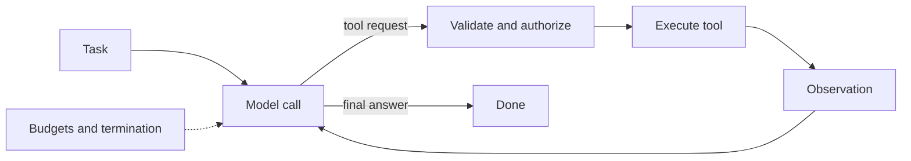

# Agents and tool use

An agent lets a model choose actions, observe results, and continue until it reaches a stopping condition. This is useful for open-ended workflows, but every additional step increases latency, cost, and the surface area for failure.

## Learning objectives

After this chapter, you can:

- implement a bounded agent loop from scratch;
- enforce step, cost, time, and per-tool budgets in code;
- define termination conditions and detect loops;
- decide which failures to retry; and
- handle a wrong tool call or a lost tool response safely.

## Mental model

> An agent is a `while` loop around a model, made safe by everything outside the model.



## Guardrails

- Give tools narrow schemas and least-privilege credentials.
- Separate read operations from consequential writes.
- Require confirmation for irreversible or high-impact actions.
- Cap steps, time, and spend.
- Validate tool arguments in code.
- Record decisions, tool calls, results, and termination reasons.

Prefer a deterministic workflow when the sequence is known. Use an agent where choosing the next step is genuinely part of the problem (see [planning](../planning/planning.md)).

## The agent loop

```python
def run_agent(task: str, tools: dict, max_steps: int = 20) -> str:
    messages = [{"role": "user", "content": task}]
    for _ in range(max_steps):
        response = llm.create(system=SYSTEM_PROMPT, messages=messages, tools=tool_schemas(tools))
        messages.append({"role": "assistant", "content": response.content})

        if response.stop_reason != "tool_use":
            return response.text  # the model chose to finish

        results = []
        for call in response.tool_calls:  # there may be several
            try:
                args = validate(call.name, call.input)
                results.append(tool_result(call.id, tools[call.name](**args)))
            except Exception as error:
                results.append(tool_result(call.id, f"ERROR: {error}", is_error=True))
        messages.append({"role": "user", "content": results})

    raise BudgetExceeded(f"No answer after {max_steps} steps")
```

`llm`, `tool_schemas`, `validate`, and `tool_result` are placeholders for a provider client and helpers. Everything else in this handbook hardens this loop: what enters `messages` ([context engineering](../memory/context-engineering.md)), what `validate` checks ([tool calling](../tool-calling/tool-calling.md)), when to stop (below), and how to survive a crash ([checkpointing and recovery](../memory/checkpointing-and-recovery.md)).

## Budgets and termination

### Termination conditions

- The model returns a final answer with no tool request.
- The model calls an explicit `finish(result)` tool, which is easier to detect and validate than free text.
- A goal check passes: tests are green, or a verifier approves.
- A budget is exhausted: stop gracefully with partial results and a stated reason.
- **Loop detection:** the same tool with the same arguments is called repeatedly, or state stops changing for several steps.

### Action budgets

Enforce budgets in code, not in the prompt:

```python
from dataclasses import dataclass, field


@dataclass
class Budget:
    max_steps: int = 25
    max_tool_calls: dict[str, int] = field(default_factory=lambda: {"send_email": 3, "refund": 1})
    max_cost_usd: float = 2.00
    max_wall_seconds: int = 300
```

Telling the model its remaining budget helps it prioritize; code still enforces the limit.

## Retries and timeouts

| Failure | Retry? | How |
| --- | --- | --- |
| Model rate limit or server error | Yes | Exponential backoff with jitter, honor `Retry-After`, then a fallback model |
| Transient tool failure (timeout, 503) | Only if the call is idempotent or carries an idempotency key | Bounded attempts |
| Tool validation error | Return it to the model to fix | Limit self-corrections |
| Tool business error, such as insufficient funds | No | Return to the model or the user |
| Unparseable model output | Once, with the error as feedback | Then fail |

Set timeouts per model call, per tool call, per step, and per run. A timeout does not mean the action did not happen; see the interview answer below. General reliability controls are in [reliability](../production/reliability.md).

## Common misconceptions

- **Misconception:** The prompt can enforce a step limit.
  **Correction:** Only code can. The prompt can inform; the loop must enforce.
- **Misconception:** Retrying a failed tool call is always safe.
  **Correction:** Only for idempotent calls. Otherwise a retry can duplicate a side effect.

## Production considerations

- Trace every step with its inputs, outputs, cost, and termination reason (see [observability](../production/observability.md)).
- Measure tool-selection accuracy and harmful-action rate in evaluation (see [evaluation](../production/evaluation.md)).
- Give each agent only the tools its task needs.

## Interview questions

### What happens when an agent calls the wrong tool, or a tool succeeds but its response is lost?

<details markdown="1">
<summary>Answer</summary>

**Wrong tool: first classify the blast radius.** A wrong read-only call—searching orders instead of tickets—costs tokens and time, and the model usually corrects itself. A wrong write, or a write with wrong arguments—refunding the wrong order, emailing the wrong customer—is the dangerous case.

Prevention:

1. Clear, non-overlapping tool names and descriptions, and fewer tools per agent, with routing to specialized agents.
2. Schema, semantic, and authorization checks in code on every call, with scope taken from the session rather than the model.
3. Risk-tiered tools: irreversible actions require a dry run and approval, and have strict per-run quotas.
4. Preconditions inside the tool, such as checking that the order belongs to the user and is refundable.

Detection and recovery:

1. Informative errors so the model can self-correct.
2. A verifier or policy engine reviewing proposed high-risk actions before execution.
3. Compensating actions—cancel or reverse—where possible, in the style of the saga pattern.
4. Tracing every call, and evaluations that measure tool-selection accuracy so regressions are caught before release.

**Lost response: the unknown-outcome problem.** A timeout, dropped connection, or worker crash can occur after the side effect but before it is recorded. The naive response—retry—duplicates the effect.

1. **Idempotency keys** derived deterministically from the run, step, tool, and canonical arguments, passed to the downstream API so a retry returns the original result.
2. **Record intent before acting and outcome after.** A record left in the intent state means the outcome is unknown: reconcile by querying the downstream system instead of retrying blindly.
3. **Idempotent tool design:** `set_status(x, "shipped")` rather than `toggle_status`; upsert rather than insert; "ensure an email was sent for event E" with deduplication on E.
4. **If the downstream is neither idempotent nor queryable,** do not retry automatically. Mark the step for human attention and tell the model not to repeat it.
5. **Tell the model the truth.** Return `{"status": "unknown", "idempotency_key": "..."}` rather than a generic error, so it does not assume failure and try a different side-effecting path.
6. **Use durable execution** so completed steps are not re-executed on resume (see [checkpointing and recovery](../memory/checkpointing-and-recovery.md)).

Agents turn every tool call into a distributed-systems problem; at-least-once delivery with idempotency is the safe default.

</details>

### Practice questions

1. Give three termination conditions and state which must be enforced in code.
   <details><summary>Answer</summary>A final answer, a passing goal check, and an exhausted budget. Budgets and loop detection must be enforced in code; the model's own decision to finish should still be validated.</details>
2. A tool times out. What are the possible states of the world, and how do you distinguish them?
   <details><summary>Answer</summary>The action never ran, it ran and succeeded, or it ran and failed. Distinguish them by querying the downstream system with the idempotency key or a business reference before deciding to retry.</details>

## Exercises

1. Implement the loop above from scratch with three tools—a search, a calculator, and a fake `send_email` that writes to a file—without a framework.
2. Add schema validation, budgets, per-tool quotas, and loop detection.
3. Make `send_email` succeed and then raise `TimeoutError` 30% of the time. Show the duplicate emails, then fix them with idempotency keys and an intent-and-outcome log.
4. Re-implement the same agent in a graph framework and compare.

## References

- Anthropic, [Building effective agents](https://www.anthropic.com/research/building-effective-agents)
- Anthropic, [Writing effective tools for agents](https://www.anthropic.com/engineering/writing-tools-for-agents)
- Yao et al., [ReAct (2022)](https://arxiv.org/abs/2210.03629)
- Stripe, [Idempotent requests](https://docs.stripe.com/api/idempotent_requests)
