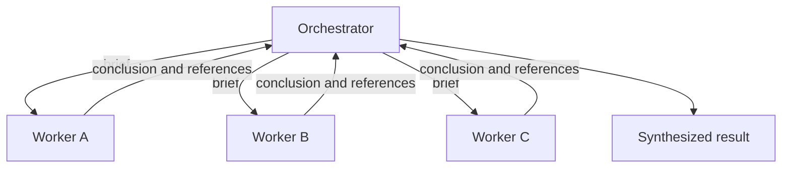

# Multi-agent systems

## Learning objectives

After this chapter, you can:

- compare orchestrator–workers, handoff, shared-state, and message-passing patterns;
- decide when specialization and parallelism justify the coordination cost;
- write a delegation brief that gives a sub-agent what it needs; and
- avoid conflicting decisions between parallel agents.

## Mental model

> A sub-agent is a new colleague with an empty context. It knows only what you tell it, and you see only what it reports back.

## Why this exists

A single context fills up, and some tasks have independent parts that could run at once. Multiple agents provide context isolation and parallelism—at the price of more tokens, more coordination, and more ways to disagree.

## Patterns

| Pattern | Context flow | Typical use |
| --- | --- | --- |
| Orchestrator–workers (supervisor) | The orchestrator sends focused briefs and receives condensed results | Research and parallel sub-tasks |
| Handoff | A full or filtered conversation is transferred to a specialist | Customer-support routing |
| Shared state (blackboard) | Agents read and write a common structured store | Pipelines and collaborative tasks |
| Message passing | Agents exchange explicit messages, possibly across services | Decoupled systems, for example using the Agent2Agent (A2A) protocol |

## Lessons from production systems

Anthropic's [multi-agent research system](https://www.anthropic.com/engineering/multi-agent-research-system) and Cognition's [Don't build multi-agents](https://cognition.ai/blog/dont-build-multi-agents) reach complementary conclusions:

- **Sub-agents do not share your context.** Write the brief as you would for a new colleague: the goal, constraints, what has been ruled out, and the expected output format.
- **Parallel agents making conflicting implicit decisions** is the main failure mode. Prefer one writer and many readers, or a single agent that uses sub-agents only for read-only exploration.
- **Return conclusions with references,** not raw dumps, to keep the parent's context clean.
- **Expect higher token use.** Anthropic reports that multi-agent systems use about fifteen times more tokens than chat interactions in its data. Use them where parallelism and context isolation pay for that.
- **Scope permissions per agent.** A research worker should not hold the payments tool.

## Common misconceptions

- **Misconception:** More agents make a system more capable.
  **Correction:** They add coordination cost and inconsistency. Specialization must earn its keep against a single-agent baseline.
- **Misconception:** Agents can coordinate implicitly through a shared goal.
  **Correction:** Unstated assumptions diverge. Make shared decisions explicit in state, or keep one decision-maker.

## Production considerations

- Trace parent and child runs together so a failure can be followed across agents.
- Enforce budgets across the whole tree, not just per agent.
- Evaluate the multi-agent system against a single-agent baseline on the same tasks.

## Interview questions

1. Why are multi-agent systems prone to inconsistent outputs, and how do you mitigate it?
   

Answer
Each agent makes implicit decisions in its own context without seeing the others'. Mitigate with a single writer, explicit shared state for decisions, detailed briefs, and read-only roles for parallel workers.

## Exercises

1. Write a delegation brief for a research sub-agent, then ask someone with no context to execute it. Note what was missing.
2. Compare a single agent with an orchestrator and three workers on five research tasks, recording quality, latency, and tokens.

## References

- Anthropic, [How we built our multi-agent research system](https://www.anthropic.com/engineering/multi-agent-research-system)
- Cognition, [Don't build multi-agents](https://cognition.ai/blog/dont-build-multi-agents)
- Anthropic, [Building effective agents](https://www.anthropic.com/research/building-effective-agents)
