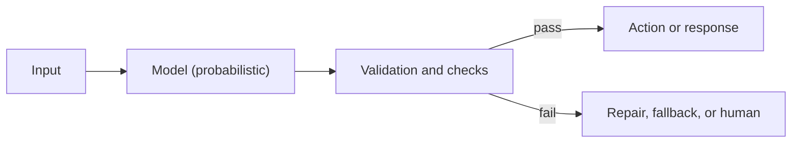

# Failure modes and nondeterminism

## Learning objectives

After this chapter, you can:

- list the main causes of hallucination and match each to a mitigation;
- explain why identical requests can produce different outputs, even at temperature 0;
- classify an observed failure using a shared taxonomy; and
- design a system that stays correct when the model is wrong or inconsistent.

## Mental model

> Treat the model as an untrusted, probabilistic component inside a deterministic system.

[LLM fundamentals](llm-fundamentals.md#why-hallucinations-happen) establishes the root cause: the model is trained to produce plausible continuations, not verified facts. This chapter expands that into the failures engineers actually see and the controls that contain them.

## Why hallucinations happen

Hallucination is fluent, confident output that is false or unsupported by the supplied context. Contributing causes:

1. **Training objective.** Next-token prediction rewards plausibility, not truth. There is no built-in fact store or abstention switch.
2. **Evaluation incentives.** OpenAI's 2025 paper [Why language models hallucinate](https://openai.com/index/why-language-models-hallucinate/) argues that accuracy-only benchmarks reward guessing over saying "I don't know," much like an exam with no penalty for wrong answers. Arbitrary, rarely seen facts—such as a specific person's birthday—cannot be inferred from patterns and are especially prone to confident errors.
3. **Knowledge cut-off.** The world changes after training ends.
4. **Lossy compression.** Rare facts are stored imprecisely in the weights.
5. **Context problems.** Relevant information is missing, buried in the middle of a long context, or contradicted by irrelevant material.
6. **Compounding generation.** Each token conditions the next, so an early error propagates.
7. **Sycophancy.** Preference tuning can reward agreement with the user over correction.

## Why the same input gives different outputs

With temperature above 0, variation is intended: the model samples from a distribution. Even at temperature 0, outputs can differ because:

- floating-point arithmetic on accelerators is not associative, so results depend on operation order;
- inference servers batch requests from many users, and kernel behavior can vary with batch composition ([Thinking Machines, Defeating nondeterminism in LLM inference](https://thinkingmachines.ai/blog/defeating-nondeterminism-in-llm-inference/));
- near-tied top tokens flip on tiny numerical differences, and autoregression makes the rest of the output diverge;
- mixture-of-experts routing can depend on other requests in the batch; and
- a model alias can be updated by the provider without any change in your code.

## Failure taxonomy

| Failure | Example | Primary mitigation |
| --- | --- | --- |
| Factual fabrication | Invented API, citation, or legal case | Grounding with retrieval, citations, verification step |
| Context unfaithfulness | A summary adds a claim absent from the source | "Answer only from context," groundedness evaluation |
| Instruction drift | A format rule is ignored late in a long conversation | Shorter contexts, restated constraints |
| Reasoning error | Arithmetic off by one | Calculator or code tools, reasoning models |
| Format failure | Invalid JSON | Structured output and validation |
| Prompt injection | The model follows instructions embedded in a web page | Architectural defenses in [security](../production/security.md) |
| Over-refusal | A benign request is declined | Clearer instructions, model choice |
| Nondeterminism | Different answers to the same input | Statistical evaluation, deterministic checks |
| Silent model change | Behavior shifts after a provider update | Pinned model versions, regression evaluation |

## Common misconceptions

- **Misconception:** A better prompt eliminates hallucination.
  **Correction:** Prompts shift probabilities. Grounding, tools, and verification are what reduce unsupported claims.
- **Misconception:** If the output is stable across runs, it is correct.
  **Correction:** A consistently wrong answer is still wrong. Stability and correctness are separate properties.
- **Misconception:** Temperature 0 makes tests reproducible.
  **Correction:** Evaluate behavior over repeated runs and judge pass rates, not single outputs.

## Production considerations

- Validate output with schemas, business rules, and—where possible—deterministic checks: compile the code, run the query, recompute the number.
- Let the model decide or extract; let code execute.
- Make side effects idempotent, because a retried decision may differ from the original (see [checkpointing and recovery](../memory/checkpointing-and-recovery.md)).
- Pin model versions and rerun the evaluation suite before upgrading.
- Log every prompt and response needed to replay a failure.

## Interview questions

### Why can't you treat an LLM as a deterministic function?

Answer

**Mechanism.** The model outputs a probability distribution and generation samples from it one token at a time, so identical inputs can legitimately produce different outputs.

**Even greedy decoding is not reproducible in practice.** Floating-point non-associativity, batch-dependent kernels, mixture-of-experts routing, and near-tied tokens can flip a token, and autoregression makes the rest diverge.

**The function itself changes.** Model aliases, safety layers, and serving infrastructure are updated by the provider.

**It is sensitive to irrelevant changes.** Reordering examples or adding an unrelated document can change the answer.

**Stable is not correct.** The model has no notion of truth, so a reproducible answer can be reproducibly wrong.

**Engineering response.** Treat output as untrusted input and validate it; keep the model in a decision role and code in an execution role; make side effects idempotent; evaluate statistically over repeated runs; pin versions and run regression evaluations; log prompts and responses for replay.

### Practice questions

1. Name three distinct reasons a temperature-0 call can return different outputs.
   

Answer
Batch-dependent floating-point results, near-tied tokens flipping on tiny numerical differences, and a provider updating the model behind an alias.

## Exercises

1. Run one prompt 20 times at temperature 0. Record how many distinct outputs you get and where they first diverge.
2. Collect ten bad outputs from a project and classify each with the taxonomy above. Which mitigation would have caught each one?
3. Design an evaluation that reports a pass rate over five runs per case instead of a single pass or fail.

## References

- OpenAI, [Why language models hallucinate (2025)](https://openai.com/index/why-language-models-hallucinate/)
- Thinking Machines, [Defeating nondeterminism in LLM inference](https://thinkingmachines.ai/blog/defeating-nondeterminism-in-llm-inference/)
- Liu et al., [Lost in the Middle (2023)](https://arxiv.org/abs/2307.03172)
