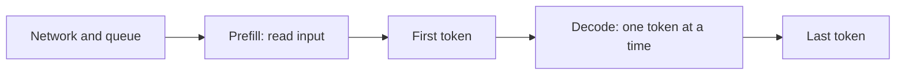

# Latency, cost, and rate limits

## Learning objectives

After this chapter, you can:

- break model latency into its components and identify which one dominates;
- estimate the token cost of a single call and of a multi-step agent;
- describe the levers that reduce cost: caching, batching, smaller models, and shorter contexts; and
- handle provider rate limits without amplifying an outage.

## Mental model

> Input tokens set the time to first token; output tokens set everything after it; every token is billed.



## Why this exists

A prototype that answers correctly can still fail as a product because it is too slow, too expensive at scale, or rejected by the provider under load. These constraints shape architecture as much as quality does.

## Latency

```text
total latency ≈ network + queueing + time to first token + (output tokens × time per output token)
```

- **Time to first token (TTFT)** is dominated by prefill and grows with input size. It determines how responsive a chat interface feels; streaming output hides much of the remaining latency from users.
- **Time per output token** reflects decode speed. Because decoding is sequential, long outputs are the main driver of total latency.
- **Reasoning tokens** produced by reasoning models are output tokens. They add latency and cost even when they are not shown to the user.

Practical consequence: ask for concise outputs, avoid making the model restate its input, and stream responses to people.

## Cost

```text
cost = input tokens × input price + output tokens × output price
       (+ cache writes and reads, + reasoning tokens)
```

Pricing changes often, but its structure has been stable. As of October 2026, Anthropic's published [pricing](https://docs.claude.com/en/docs/about-claude/pricing) shows:

- output tokens priced at five times input tokens for current Claude models;
- prompt-cache reads billed at 0.1× the base input price, with a premium for cache writes ([prompt caching](https://docs.claude.com/en/docs/build-with-claude/prompt-caching)); and
- asynchronous batch processing at half the standard price.

Other providers use similar structures with different ratios. Check current pricing before using these numbers in a forecast.

### Worked example

Assume 10,000 requests per day, 3,000 input tokens and 500 output tokens per request, priced at $3 and $15 per million tokens:

```text
per request = 3,000 × $3/1M + 500 × $15/1M = $0.009 + $0.0075 = $0.0165
per day     = 10,000 × $0.0165 = $165
per month   ≈ $4,950
```

### Why agents multiply cost

An agent sends the growing conversation back to the model on every step. A 20-step task whose context averages 30,000 tokens consumes about 600,000 input tokens before counting output. Anthropic reports that, in its data, agents use about four times more tokens than chat interactions and multi-agent systems about fifteen times more ([multi-agent research system](https://www.anthropic.com/engineering/multi-agent-research-system)). Context management (see [context engineering](../memory/context-engineering.md)) is therefore a cost control as well as a quality control.

### Cost levers

In rough order of effort:

1. Fewer steps: better tools and instructions reduce wasted calls.
2. Smaller contexts: retrieve less, clear old tool results, compact history.
3. Prompt caching: keep stable content first so it can be reused.
4. Batch processing for work that does not need an immediate answer.
5. Smaller models for sub-tasks that pass the same evaluation (see [model selection](model-selection.md) and [cost and routing](../production/cost-and-routing.md)).

## Rate limits

Providers limit requests per minute and input and output tokens per minute, typically per organization, model, and usage tier. Rate-limited requests usually return HTTP `429`; overloaded services may return `503` or a provider-specific status such as Anthropic's `529`.

```python
import random
import time


class RateLimitError(Exception):
    def __init__(self, retry_after: float | None = None):
        self.retry_after = retry_after


def call_with_backoff(fn, max_attempts: int = 6):
    for attempt in range(max_attempts):
        try:
            return fn()
        except RateLimitError as error:
            # Honor the server's hint when present; otherwise back off exponentially with jitter.
            wait = error.retry_after or min(60.0, 2**attempt + random.random())
            time.sleep(wait)
    raise RuntimeError("Model unavailable after retries")
```

Jitter prevents many clients from retrying in lockstep. Retrying without a bound converts a provider slowdown into a self-inflicted outage.

## Common misconceptions

- **Misconception:** A larger context window is free headroom.
  **Correction:** Every input token is billed and processed on every call, and quality can decline as context grows.
- **Misconception:** Hidden reasoning is free.
  **Correction:** Reasoning tokens are billed and add latency like any other output token.
- **Misconception:** The cost of an agent is the cost of one call times the number of steps.
  **Correction:** Each step re-sends a growing history, so cost grows faster than linearly in the number of steps.

## Production considerations

- Measure tokens, TTFT, and total latency per call and per task; report **cost per successful task**, not cost per call.
- Put a client-side token budget and queue in front of the provider so priority traffic is protected under rate limits.
- Use fallback models or providers for availability, with the caveats in [reliability](../production/reliability.md).
- Record pricing assumptions with a date next to any forecast.

## Interview questions

1. A chat feature feels slow. How do you decide whether to shorten the prompt or shorten the output?
   <details><summary>Answer</summary>Measure TTFT and total latency separately. A long TTFT points to input size, queueing, or network; a long tail after the first token points to output length. Streaming improves perceived latency in both cases.</details>
2. Estimate the monthly input-token volume of a 15-step agent averaging 20,000 input tokens per step at 5,000 tasks per day.
   <details><summary>Answer</summary>15 × 20,000 × 5,000 = 1.5 billion input tokens per day, about 45 billion per month—before output tokens. Caching and context reduction matter more than per-token price at this scale.</details>

## Exercises

1. Call a model API directly and log input tokens, output tokens, TTFT, and total latency for 20 requests.
2. Repeat with a long, stable system prompt placed first and enable prompt caching. Compare cost and TTFT.
3. Simulate `429` responses and verify that your retry logic honors `Retry-After` and stops after a bounded number of attempts.

## References

- Anthropic, [Pricing](https://docs.claude.com/en/docs/about-claude/pricing)
- Anthropic, [Prompt caching](https://docs.claude.com/en/docs/build-with-claude/prompt-caching)
- Anthropic, [How we built our multi-agent research system](https://www.anthropic.com/engineering/multi-agent-research-system)
