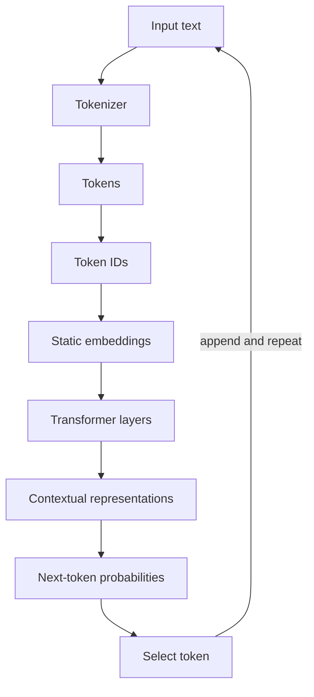
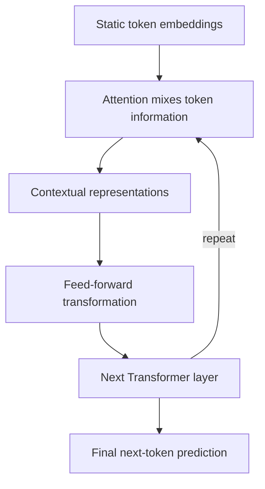
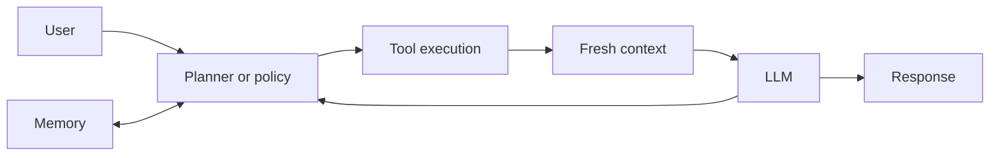

# LLM fundamentals

## Learning objectives

After this chapter, you can:

- distinguish tokens, token IDs, static embeddings, and contextual representations;
- explain the problem self-attention solves;
- describe how a Transformer produces a next-token prediction;
- explain why fluent generation can still be factually wrong;
- explain how tokenizers, the context window, and the KV cache affect cost and latency;
- distinguish embedding models from generative models; and
- identify what an agent adds around an LLM.

## The governing mental model

> An LLM is a next-token prediction engine, not a knowledge engine.

Given a context, the model produces a probability distribution over the next token:

```text
f(context) -> P(next token | context)
```

The generated token is appended to the context and the process repeats. Knowledge, reasoning-like behavior, and instruction following emerge through training, scale, and context, but the core runtime operation remains next-token prediction.

An LLM does not inherently browse the web, query a database, retain durable memory, or execute code. Applications provide those capabilities through retrieval, tools, memory systems, and control logic.

## From text to a prediction



Each stage solves a different problem. Collapsing them into the vague idea that the model "understands words" hides the most useful engineering distinctions.

## Tokens are not words

A token is whatever unit the tokenizer emits. Depending on the tokenizer and input, it can be:

- a whole word;
- part of a word;
- punctuation;
- whitespace; or
- another text fragment.

For example, a tokenizer might split:

```text
extraordinary -> ["extra", "ordinary"]
```

Tokenization is not linguistic normalization. The number of tokens affects context-window use, latency, and cost, so applications should measure with the model's actual tokenizer rather than estimate from word count.

### How tokenizers are built

Most modern tokenizers use byte-pair encoding (BPE) or a close variant such as SentencePiece or tiktoken. The tokenizer is trained before the model:

1. Start from bytes or characters.
2. Repeatedly merge the most frequent adjacent pair into a new vocabulary entry.
3. Stop when the vocabulary reaches its target size.

Frequent strings therefore become single tokens and rare strings are split into several pieces:

```text
"the"          -> ["the"]
"unbelievable" -> ["un", "believ", "able"]
"2026-10-29"   -> ["202", "6", "-", "10", "-", "29"]
```

The exact splits differ between tokenizers; these are illustrations, not the output of a specific model.

A frequently quoted rule of thumb is roughly four characters of English text per token. Treat it as an estimate only. Code, JSON, numbers, and non-Latin scripts usually need more tokens for the same content.

### Symptoms that come from tokenization

| Symptom | Tokenization cause |
| --- | --- |
| Miscounting letters in a word | The model sees subword tokens, not individual letters |
| Unreliable arithmetic on long numbers | Digits are grouped inconsistently into tokens |
| Higher cost for some languages | Fewer merges were learned for those scripts, so text needs more tokens |
| JSON output is expensive | Braces, quotes, and repeated keys each consume tokens |
| The same prompt costs differently across providers | Each model family has its own tokenizer |

### The context window

The context window is the maximum number of tokens—input plus output—that the model can process in one call. It is the model's entire working space: nothing persists between calls unless the application sends it again.

A larger window is not free:

- cost grows with input tokens and latency grows with input and output length;
- models use information placed in the middle of long contexts less reliably than information near the beginning or end ([Liu et al., "Lost in the Middle"](https://arxiv.org/abs/2307.03172)); and
- quality tends to degrade as a context fills with loosely relevant material, which practitioners call *context rot* (see [context engineering](../memory/context-engineering.md)).

Output length has its own, smaller limit, usually set with a `max_tokens` parameter.

## Token IDs are arbitrary labels

After tokenization, each token maps to an integer in the model's vocabulary:

```text
cat   -> 101
dog   -> 205
apple -> 876
```

The integers identify vocabulary entries; their numeric distances carry no semantic meaning. The model cannot conclude that `cat` resembles `dog` by comparing `101` and `205`.

## Embeddings provide a semantic starting point

An embedding table maps each token ID to a learned dense vector:

```text
Paris -> [0.28, -0.61, 0.91, ...]
```

Training arranges these vectors so useful semantic and syntactic relationships can be represented continuously. Similar concepts often occupy related regions, allowing neural-network operations that arbitrary IDs cannot support.

The initial embedding is static: the token `bank` begins with the same learned vector whether the sentence concerns money or a river. It is a prior representation, not the final meaning in context.

## Self-attention creates context

Self-attention lets every token weigh information from other tokens in the sequence. It answers a practical question: *which surrounding tokens matter when updating this token's representation?*

Consider:

```text
The cat chased the mouse because it was hungry.
```

Resolving `it` requires relationships elsewhere in the sentence. Attention mixes relevant information into a new representation for each position.

At a high level, each token produces:

- a **query** describing the information it seeks;
- a **key** describing the information it offers; and
- a **value** carrying the information that may be mixed in.

Query-key compatibility determines attention weights. Weighted values are combined to update the token representation. Multi-head attention performs several such relationship searches in parallel.

In matrix form, scaled dot-product attention is:

```text
Attention(Q, K, V) = softmax(Q · Kᵀ / √d) · V
```

`Q · Kᵀ` scores every query against every key, dividing by `√d` (the vector dimension) keeps the scores in a range where softmax still produces useful gradients, and softmax turns each row of scores into weights that sum to one. The result is a weighted mix of value vectors for every position ([Vaswani et al., 2017](https://arxiv.org/abs/1706.03762)).

Decoder-only LLMs apply a **causal mask**: a position may attend only to itself and earlier positions. That restriction is what makes left-to-right generation possible—the model never relies on tokens it has not produced yet.

Because every position is compared with every earlier position, naive attention cost grows quadratically with sequence length. Optimized kernels and attention variants reduce the constant factor, but long inputs remain slower and more expensive than short ones.

## Transformers build contextual representations

An initial embedding is like a person's identity; context determines the role the person is playing now. `John` may be driving in one sentence and cooking in another. Likewise, the initial identity of `bank` is refined differently by `deposit` and `money` than by `river` and `shore`.



The vectors change after every layer. Only the lookup-table embedding at the input is static. Repeated attention and feed-forward transformations create progressively richer contextual representations.

## Why embeddings alone are insufficient

Embeddings encode useful prior relationships, but language depends on order, role, reference, and long-range context. A static vector cannot by itself decide whether `bank` means a financial institution or the side of a river.

The distinction is:

- **Embedding:** a learned semantic starting point for a token.
- **Transformer:** a mechanism that repeatedly turns those starting points into context-dependent representations.

## Embedding models versus generative models

The token embeddings inside a Transformer are different from the vectors returned by an *embedding model* API. An embedding model is trained to compress a whole passage into one fixed-length vector so passages can be compared. A generative model is trained to produce new tokens.

| | Embedding model | Generative model |
| --- | --- | --- |
| Output | One fixed-length vector per input | A sequence of tokens |
| Purpose | Compare meaning: search, clustering, deduplication, classification | Produce text: answers, summaries, tool calls |
| Repeatability | Same vector for the same input and model version | Varies by default because output is sampled |
| Relative cost | Low | Much higher per token |

Similarity between two embeddings is usually measured with cosine similarity:

```python
import numpy as np


def cosine(a: np.ndarray, b: np.ndarray) -> float:
    return float(np.dot(a, b) / (np.linalg.norm(a) * np.linalg.norm(b)))
```

Three properties matter in practice:

- Vectors from different embedding models are not comparable. Changing the model means re-embedding the whole corpus.
- Embeddings capture topical similarity, not truth. Negation, exact numbers, and identifiers such as `E1234` versus `E1243` are often poorly separated, which is why retrieval systems combine embeddings with keyword search (see [retrieval and ranking](../rag/retrieval-and-ranking.md)).
- An embedding is a representation for comparison; it never generates an answer by itself.

## Inference mechanics: prefill, decode, and the KV cache

Generation has two phases with different performance characteristics:

- **Prefill** processes the whole input in parallel and produces the first output token. Its duration grows with input length and determines time to first token.
- **Decode** produces output one token at a time, because each token depends on the previous ones. Output length therefore dominates total latency.

During decoding, the keys and values already computed for earlier positions are stored in a **KV cache**, so each new token attends to cached vectors instead of recomputing the whole sequence.

Providers extend the same idea across requests with **prompt caching**: if a new request begins with exactly the same prefix as a recent one, the cached computation for that prefix can be reused, lowering cost and latency. Because only an identical prefix can be reused, stable content—system instructions, tool definitions, reference documents—belongs at the start of the prompt. Pricing consequences are covered in [latency, cost, and rate limits](latency-cost-and-rate-limits.md).

Autoregressive decoding has a reliability consequence too: every token is conditioned on the tokens before it, including the model's own earlier mistakes. An early wrong token can steer the rest of the output.

## How training shapes behavior

A deployed chat model is usually the product of several training stages:

1. **Pretraining:** next-token prediction over a very large text corpus. The model acquires language patterns and a lossy store of facts.
2. **Supervised fine-tuning:** training on curated instruction-and-response examples, so the model follows instructions instead of merely continuing text.
3. **Preference and reinforcement tuning:** methods such as reinforcement learning from human or AI feedback, direct preference optimization, and reinforcement learning on verifiable tasks shape helpfulness, safety, reasoning, and tool use.

Each stage explains observable behavior. Pretraining explains broad knowledge with a cut-off date. Instruction tuning explains why prompts work as task descriptions (see [prompt engineering](../prompting/prompt-engineering.md)). Preference tuning can also reward agreeable answers, one source of the sycophancy described in [failure modes and nondeterminism](failure-modes-and-nondeterminism.md).

## Why hallucinations happen

The training objective rewards plausible next-token prediction, not fact verification. A fluent continuation can therefore be unsupported, stale, or wrong while remaining statistically plausible.

Limited or ambiguous context can contribute, but it is not the root cause. The model does not automatically consult an authoritative source before generating.

Systems reduce this risk by adding:

- retrieval from a controlled knowledge base;
- database, API, search, or calculation tools;
- citations and evidence checks;
- deterministic validation; and
- human review for consequential decisions.

These controls ground or verify output; they do not turn the base model into an infallible fact store.

The full set of contributing causes and a failure taxonomy are in [failure modes and nondeterminism](failure-modes-and-nondeterminism.md).

## From LLM to agent

An agent surrounds the model with a loop that can select actions, observe their results, maintain relevant state, and decide when to stop.



For a live-data question, the useful path is not "ask the model to remember harder." It is:

```text
planner -> tool -> fresh context -> LLM -> response
```

The four useful conceptual components are planning or control, tool execution, memory or state, and LLM inference. Real implementations may combine or split these responsibilities.

## Common misconceptions

- **Token means normalized word.** A token is simply a tokenizer output unit.
- **Token IDs encode relationships.** They are arbitrary vocabulary identifiers.
- **Embeddings completely understand language.** Initial embeddings provide learned priors; context is constructed through Transformer layers.
- **Attention is memory.** Attention relates tokens in the current context; durable memory is an external system concern.
- **Hallucination is only a missing-context problem.** The deeper issue is an objective that generates likely text rather than verifies truth.
- **An LLM automatically knows live data.** Live information requires an external source and a tool or retrieval path.

## Production considerations

- Count tokens with the exact deployed tokenizer when enforcing limits or estimating cost.
- Treat generated text as untrusted input and validate any structured or consequential output.
- Record model, prompt, tool, and retrieval versions so behavior can be reproduced.
- Measure task success separately from fluency.
- Provide authoritative data sources for factual, changing, or private information.
- Bound agent steps, permissions, latency, and spend outside the model.

## Interview-ready answers

### Why do models use embeddings instead of token IDs?

Token IDs are arbitrary labels with no meaningful numeric relationships. Embeddings map them into learned continuous vectors where the network can represent semantic and syntactic relationships.

### Why is a Transformer needed if embeddings contain meaning?

Initial embeddings are static and cannot represent a token's role in a particular sentence. Transformer layers use self-attention and feed-forward transformations to produce context-dependent representations at every position.

### Why do LLMs hallucinate?

An LLM is optimized to produce a likely continuation, not to verify every claim against an authoritative source. Retrieval, tools, validation, and review add grounding and verification around that generator.

### How can an agent answer a live-data question?

Control logic selects an appropriate tool, the tool retrieves current data, and that result is added to the model's context before it generates a response.

## Exercises

1. Pick five strings—one ordinary word, one long word, punctuation, code, and non-English text—and inspect how a real tokenizer splits them.
2. Explain static versus contextual embeddings using an analogy from a backend system.
3. Design the tool path for answering "How many orders failed in the last hour?" Include authorization, validation, and failure behavior.
4. Identify which parts of that system are deterministic and which are probabilistic.
5. Tokenize the same paragraph in English, Hindi, and as JSON with a real tokenizer. Compare the token counts.
6. Explain what the KV cache stores and why prompt caching requires an identical prefix.
7. When would you use an embedding model instead of asking a chat model whether two texts are similar?

## References

- Vaswani et al., [Attention Is All You Need (2017)](https://arxiv.org/abs/1706.03762)
- Jay Alammar, [The Illustrated Transformer](https://jalammar.github.io/illustrated-transformer/)
- 3Blue1Brown, [Attention in transformers, visually explained](https://www.youtube.com/watch?v=eMlx5fFNoYc)
- Andrej Karpathy, [Let's build the GPT tokenizer](https://www.youtube.com/watch?v=zduSFxRajkE) and [Intro to large language models](https://www.youtube.com/watch?v=zjkBMFhNj_g)
- Liu et al., [Lost in the Middle: How Language Models Use Long Contexts (2023)](https://arxiv.org/abs/2307.03172)

## Learning journal

The [Module 1 Q&A and insights](llm-fundamentals-qa.md) preserve the original answers, corrections, and questions to revisit.
