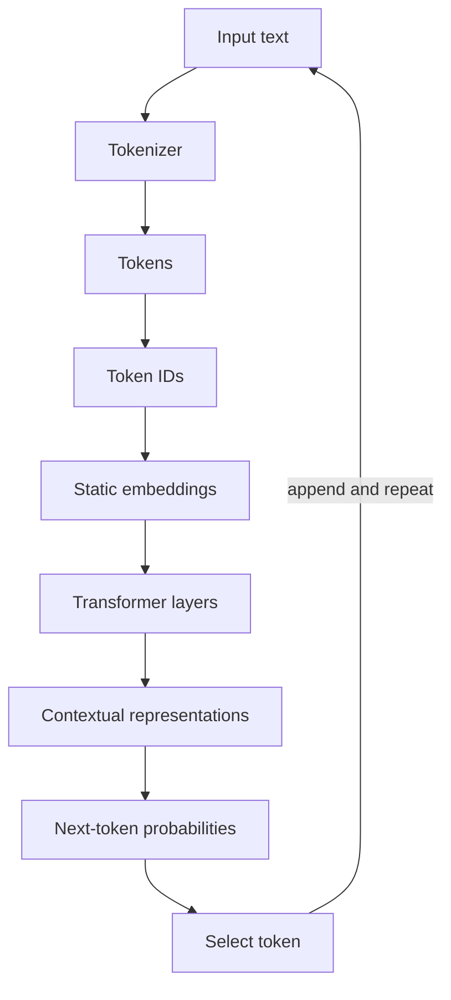
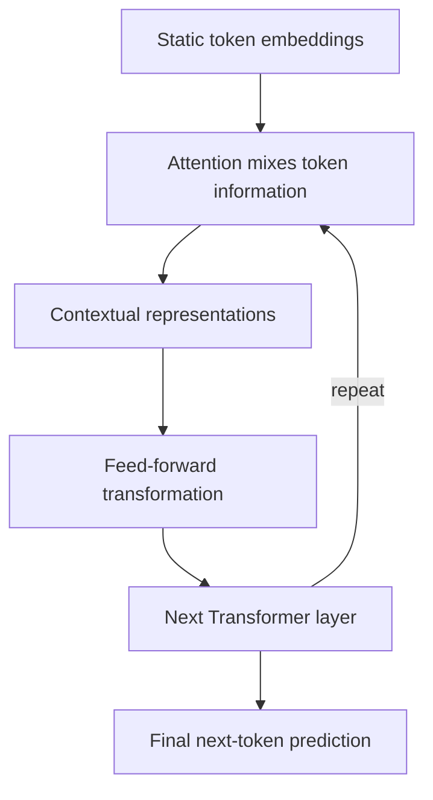
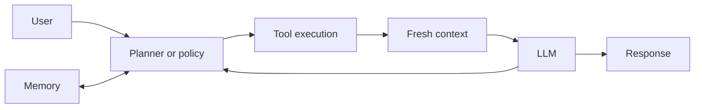

# LLM fundamentals

## Learning objectives

After this chapter, you can:

- distinguish tokens, token IDs, static embeddings, and contextual representations;
- explain the problem self-attention solves;
- describe how a Transformer produces a next-token prediction;
- explain why fluent generation can still be factually wrong; and
- identify what an agent adds around an LLM.

## The governing mental model

> An LLM is a next-token prediction engine, not a knowledge engine.

Given a context, the model produces a probability distribution over the next token:

```text
f(context) -> P(next token | context)
```

The generated token is appended to the context and the process repeats. Knowledge, reasoning-like behavior, and instruction following emerge through training, scale, and context, but the core runtime operation remains next-token prediction.

An LLM does not inherently browse the web, query a database, retain durable memory, or execute code. Applications provide those capabilities through retrieval, tools, memory systems, and control logic.

## From text to a prediction



Each stage solves a different problem. Collapsing them into the vague idea that the model "understands words" hides the most useful engineering distinctions.

## Tokens are not words

A token is whatever unit the tokenizer emits. Depending on the tokenizer and input, it can be:

- a whole word;
- part of a word;
- punctuation;
- whitespace; or
- another text fragment.

For example, a tokenizer might split:

```text
extraordinary -> ["extra", "ordinary"]
```

Tokenization is not linguistic normalization. The number of tokens affects context-window use, latency, and cost, so applications should measure with the model's actual tokenizer rather than estimate from word count.

## Token IDs are arbitrary labels

After tokenization, each token maps to an integer in the model's vocabulary:

```text
cat   -> 101
dog   -> 205
apple -> 876
```

The integers identify vocabulary entries; their numeric distances carry no semantic meaning. The model cannot conclude that `cat` resembles `dog` by comparing `101` and `205`.

## Embeddings provide a semantic starting point

An embedding table maps each token ID to a learned dense vector:

```text
Paris -> [0.28, -0.61, 0.91, ...]
```

Training arranges these vectors so useful semantic and syntactic relationships can be represented continuously. Similar concepts often occupy related regions, allowing neural-network operations that arbitrary IDs cannot support.

The initial embedding is static: the token `bank` begins with the same learned vector whether the sentence concerns money or a river. It is a prior representation, not the final meaning in context.

## Self-attention creates context

Self-attention lets every token weigh information from other tokens in the sequence. It answers a practical question: *which surrounding tokens matter when updating this token's representation?*

Consider:

```text
The cat chased the mouse because it was hungry.
```

Resolving `it` requires relationships elsewhere in the sentence. Attention mixes relevant information into a new representation for each position.

At a high level, each token produces:

- a **query** describing the information it seeks;
- a **key** describing the information it offers; and
- a **value** carrying the information that may be mixed in.

Query-key compatibility determines attention weights. Weighted values are combined to update the token representation. Multi-head attention performs several such relationship searches in parallel.

## Transformers build contextual representations

An initial embedding is like a person's identity; context determines the role the person is playing now. `John` may be driving in one sentence and cooking in another. Likewise, the initial identity of `bank` is refined differently by `deposit` and `money` than by `river` and `shore`.



The vectors change after every layer. Only the lookup-table embedding at the input is static. Repeated attention and feed-forward transformations create progressively richer contextual representations.

## Why embeddings alone are insufficient

Embeddings encode useful prior relationships, but language depends on order, role, reference, and long-range context. A static vector cannot by itself decide whether `bank` means a financial institution or the side of a river.

The distinction is:

- **Embedding:** a learned semantic starting point for a token.
- **Transformer:** a mechanism that repeatedly turns those starting points into context-dependent representations.

## Why hallucinations happen

The training objective rewards plausible next-token prediction, not fact verification. A fluent continuation can therefore be unsupported, stale, or wrong while remaining statistically plausible.

Limited or ambiguous context can contribute, but it is not the root cause. The model does not automatically consult an authoritative source before generating.

Systems reduce this risk by adding:

- retrieval from a controlled knowledge base;
- database, API, search, or calculation tools;
- citations and evidence checks;
- deterministic validation; and
- human review for consequential decisions.

These controls ground or verify output; they do not turn the base model into an infallible fact store.

## From LLM to agent

An agent surrounds the model with a loop that can select actions, observe their results, maintain relevant state, and decide when to stop.



For a live-data question, the useful path is not "ask the model to remember harder." It is:

```text
planner -> tool -> fresh context -> LLM -> response
```

The four useful conceptual components are planning or control, tool execution, memory or state, and LLM inference. Real implementations may combine or split these responsibilities.

## Common misconceptions

- **Token means normalized word.** A token is simply a tokenizer output unit.
- **Token IDs encode relationships.** They are arbitrary vocabulary identifiers.
- **Embeddings completely understand language.** Initial embeddings provide learned priors; context is constructed through Transformer layers.
- **Attention is memory.** Attention relates tokens in the current context; durable memory is an external system concern.
- **Hallucination is only a missing-context problem.** The deeper issue is an objective that generates likely text rather than verifies truth.
- **An LLM automatically knows live data.** Live information requires an external source and a tool or retrieval path.

## Production considerations

- Count tokens with the exact deployed tokenizer when enforcing limits or estimating cost.
- Treat generated text as untrusted input and validate any structured or consequential output.
- Record model, prompt, tool, and retrieval versions so behavior can be reproduced.
- Measure task success separately from fluency.
- Provide authoritative data sources for factual, changing, or private information.
- Bound agent steps, permissions, latency, and spend outside the model.

## Interview-ready answers

### Why do models use embeddings instead of token IDs?

Token IDs are arbitrary labels with no meaningful numeric relationships. Embeddings map them into learned continuous vectors where the network can represent semantic and syntactic relationships.

### Why is a Transformer needed if embeddings contain meaning?

Initial embeddings are static and cannot represent a token's role in a particular sentence. Transformer layers use self-attention and feed-forward transformations to produce context-dependent representations at every position.

### Why do LLMs hallucinate?

An LLM is optimized to produce a likely continuation, not to verify every claim against an authoritative source. Retrieval, tools, validation, and review add grounding and verification around that generator.

### How can an agent answer a live-data question?

Control logic selects an appropriate tool, the tool retrieves current data, and that result is added to the model's context before it generates a response.

## Exercises

1. Pick five strings—one ordinary word, one long word, punctuation, code, and non-English text—and inspect how a real tokenizer splits them.
2. Explain static versus contextual embeddings using an analogy from a backend system.
3. Design the tool path for answering "How many orders failed in the last hour?" Include authorization, validation, and failure behavior.
4. Identify which parts of that system are deterministic and which are probabilistic.

## Learning journal

The [Module 1 Q&A and insights](llm-fundamentals-qa.md) preserve the original answers, corrections, and questions to revisit.
