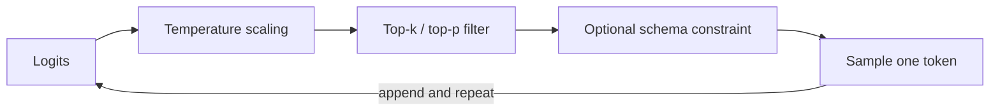

# Sampling and structured output

## Learning objectives

After this chapter, you can:

- explain how temperature, top-k, and top-p turn next-token probabilities into a chosen token;
- choose sampling settings for extraction, decision, and creative tasks;
- compare prompting, JSON mode, tool calling, and constrained decoding for machine-readable output; and
- validate structured output so a schema-valid but wrong answer is still caught.

## Mental model

> The model proposes a probability distribution; the sampler chooses one token from it.

Sampling settings change *how* a token is selected, not what the model knows. Structured-output features change *which* tokens are allowed, not whether the content is correct.



At every step the model produces logits—one raw score per vocabulary entry. Temperature rescales them, filters remove unlikely candidates, an optional constraint masks tokens that would break a schema, and one token is drawn.

## Why this exists

A model that always picked the single most likely token would be repetitive and occasionally stuck in loops, while a model that sampled from the full distribution would sometimes pick nonsense from the long tail. Sampling parameters let an application trade consistency against variety per task.

Applications also need output that code can consume. Free text is ambiguous; a downstream system needs a field it can read without guessing.

## How sampling works

| Parameter | Effect | Typical use |
| --- | --- | --- |
| Temperature `T` | Computes `softmax(logits / T)`. Values near 0 concentrate probability on the top token; values above 1 flatten the distribution | Low for extraction, classification, and tool selection; higher for brainstorming and creative writing |
| Top-k | Keeps only the `k` most likely tokens | Removes the long tail of unlikely tokens |
| Top-p (nucleus) | Keeps the smallest set of tokens whose cumulative probability reaches `p` | An adaptive version of top-k |
| Stop sequences | Ends generation when a given string appears | Delimiting output |
| `max_tokens` | Caps output length | Bounding cost and latency; a cut-off can truncate structured output |
| Seed (some providers) | Requests best-effort repeatability | Debugging only, not a guarantee |

Some reasoning-oriented models fix or ignore sampling parameters. Check the provider's documentation for the specific model before relying on them.

A temperature of 0 is not a determinism guarantee. The reasons are covered in [failure modes and nondeterminism](failure-modes-and-nondeterminism.md).

## How structured output works

There are four common ways to obtain machine-readable output, in increasing order of guarantee:

1. **Prompting:** describe the format in the instructions. Usually works; occasionally produces invalid output.
2. **JSON mode:** the provider guarantees syntactically valid JSON, but not your schema.
3. **Tool or function calling:** the model fills arguments for a schema you declare (see [tool calling](../tool-calling/tool-calling.md)).
4. **Constrained decoding:** during sampling, tokens that would make the output invalid against a JSON Schema or grammar are masked out. Many providers expose this as a "structured outputs" or "strict" mode.

Constrained decoding guarantees **shape**, not **correctness**. A perfectly valid object can still contain the wrong category or an invented value.

## Minimal example

Validate every structured response and allow one repair attempt with the validation error as feedback:

```python
from pydantic import BaseModel, Field, ValidationError


class Ticket(BaseModel):
    category: str = Field(pattern="^(billing|bug|feature)$")
    priority: int = Field(ge=1, le=4)
    summary: str


def extract_ticket(call_llm, prompt: str) -> Ticket:
    raw = call_llm(prompt)
    try:
        return Ticket.model_validate_json(raw)
    except ValidationError as error:
        repaired = call_llm(f"{prompt}\n\nYour previous output was invalid: {error}. Return corrected JSON only.")
        return Ticket.model_validate_json(repaired)  # A second failure propagates to the caller.
```

`call_llm` is a placeholder for any provider client. The pattern—validate, repair once, then fail loudly—matters more than the library.

## Common misconceptions

- **Misconception:** Temperature 0 makes the model deterministic.
  **Correction:** It makes selection greedy, but infrastructure effects still change outputs. Design for variation.
- **Misconception:** A schema-constrained response is a correct response.
  **Correction:** Constraints guarantee structure only. Business rules and content still need validation.
- **Misconception:** Higher temperature makes the model more creative in a useful sense.
  **Correction:** It samples less likely tokens more often, which increases variety and error rate together.

## Production considerations

- Use low temperature and structured output for steps whose result drives code: routing, classification, extraction, and tool arguments.
- Forcing a strict format can reduce reasoning quality on hard tasks. Let the model reason in a free-text field or a separate step first, then fill the structured answer.
- Set `max_tokens` with headroom for structured responses; truncation produces invalid JSON.
- Cap repair attempts. Repeated repair loops increase cost without improving a systematically wrong answer.
- Log the raw output alongside the parsed result so validation failures can be investigated.

## Interview questions

1. What does temperature change mathematically, and why is a low temperature usually right for tool selection?
   <details><summary>Answer</summary>It divides the logits before softmax. Low values concentrate probability on the most likely token, which makes decisions that drive code more consistent; creative variety is not useful there.</details>
2. Your extraction pipeline returns schema-valid JSON with wrong values 3% of the time. Does constrained decoding fix it?
   <details><summary>Answer</summary>No. Constrained decoding only guarantees shape. Improve the prompt and context, add semantic validation and business-rule checks, and measure the error rate on an evaluation set.</details>

## Exercises

1. Run the same prompt 20 times at temperature 0 and at temperature 1. Count the distinct outputs for each.
2. Implement structured extraction with a schema and one repair attempt. Measure the failure rate over 100 varied inputs.
3. Compare prompting-only JSON with a provider's strict structured-output mode on the same inputs.

## References

- OpenAI, [Function calling and structured outputs](https://platform.openai.com/docs/guides/function-calling)
- Anthropic, [Tool use overview](https://docs.claude.com/en/docs/agents-and-tools/tool-use/overview)
