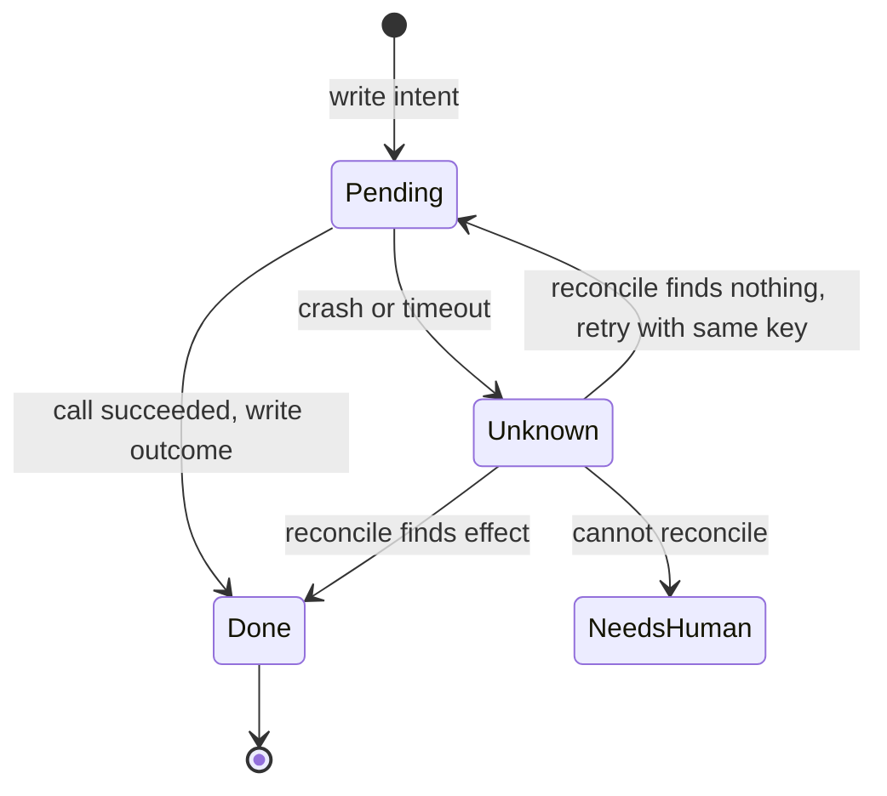

# Checkpointing and recovery

## Learning objectives

After this chapter, you can:

- persist an agent run so another worker can resume it after a crash;
- explain what re-executes on resume in checkpoint-based and replay-based engines;
- implement a side-effect ledger with idempotency keys and reconciliation; and
- resume an agent without repeating a payment or other irreversible action.

## Mental model

> Replay must be deterministic, side effects must be idempotent, and the record of an effect must be durable before anything relies on it.

Exactly-once execution across a network does not exist. Systems achieve exactly-once *effects* with at-least-once delivery, idempotency keys, and reconciliation of unknown outcomes.



## Why this exists

Agent runs can last minutes or days, call slow external systems, and pause for human approval. Processes restart, deployments roll, and networks drop responses. Without durable state, a crash either loses work or repeats it—and repeating a payment is worse than losing a draft.

## Checkpointing

After each step, persist the run identifier, step identifier, structured state, the next step, and the side-effect ledger. On restart, a worker loads the latest checkpoint and continues.

Two families of tooling exist:

- **Checkpointing graphs.** In LangGraph, a checkpointer saves state per step under a thread identifier, enabling resume, inspection, and human-in-the-loop interrupts. Its [durable execution](https://docs.langchain.com/oss/python/langgraph/durable-execution) documentation describes three durability modes that trade speed for safety: `exit` persists only when the run exits, `async` persists in the background and can lose the latest checkpoint on a crash, and `sync` persists before the next step starts. On resume, steps after the last checkpoint **run again**, so side effects must be idempotent or wrapped as separate tasks.
- **Durable-execution engines.** Temporal, Restate, and DBOS replay a workflow from an event history. Completed *activities*—the units that perform side effects—are not re-run; their recorded results are returned. Model calls are non-deterministic and should be activities too ([Temporal, What is durable execution?](https://temporal.io/blog/what-is-durable-execution)).

## The side-effect ledger

Record intent before acting and outcome after:

```python
def execute_side_effect(state, step_id: str, tool, args: dict):
    key = idempotency_key(state.run_id, step_id, tool.name, args)
    record = ledger.get(key)
    if record and record.status == "DONE":
        return record.result                         # already happened: reuse the result
    if record and record.status == "PENDING":
        return reconcile(tool, key)                  # outcome unknown: ask the downstream system
    ledger.put(key, status="PENDING", args=args)     # durable intent before acting
    result = tool.call(**args, idempotency_key=key)
    ledger.put(key, status="DONE", result=result)    # durable outcome after acting
    return result
```

The key must be **derived deterministically** from the run, step, tool, and canonical arguments, so a resumed worker computes the same key. A random key generated at call time defeats the purpose. Payment providers such as Stripe accept an [idempotency key](https://docs.stripe.com/api/idempotent_requests) and return the original result for a repeated request; Brandur Leach's [idempotency keys in PostgreSQL](https://brandur.org/idempotency-keys) shows how to build the same guarantee into your own API.

## Human-in-the-loop interrupts

Checkpointing also enables pausing. The run stops at an interrupt, persists its state, and resumes—possibly days later—with the human's decision. In LangGraph, the node containing the interrupt runs again from its start on resume, so code before the interrupt must have no side effects. Approval design is covered in [human approval](../production/human-approval.md).

## Common misconceptions

- **Misconception:** A timeout means the action did not happen.
  **Correction:** It means the outcome is unknown. Reconcile before retrying.
- **Misconception:** On resume, ask the model what to do next.
  **Correction:** Replay the recorded decision. A fresh model call may decide differently and act twice.
- **Misconception:** Checkpointing alone prevents duplicates.
  **Correction:** Work after the last checkpoint re-executes. Idempotency prevents duplicates.

## Production considerations

- Use leases with heartbeats and fencing tokens so a stalled worker cannot act after its run has been reassigned.
- Alert on ledger entries left `PENDING` beyond a threshold.
- Run a periodic reconciliation job that compares the ledger with downstream systems.
- Back idempotency with database uniqueness constraints on business keys.

## Interview questions

### How do you resume an agent after a worker crashes without repeating a payment or other irreversible action?

<details markdown="1">
<summary>Answer</summary>

Combine durable state, idempotent effects, and reconciliation.

1. **Persist the run, not just the chat.** Every step writes a checkpoint—run, step, structured state, next step—before moving on. When a worker dies, another picks up the run after its lease expires; a fencing token ensures only one worker can act.
2. **Separate deciding from doing.** The model proposes `pay(invoice="INV-9", amount=120.00)` and that decision is persisted. Execution is a separate deterministic step. On resume, replay the recorded decision instead of asking the model again.
3. **Derive an idempotency key per logical action** from the run, step, tool, and canonical arguments, so the resumed worker computes the same key, and pass it to the payment provider. A duplicate request returns the original charge.
4. **Keep an intent-and-outcome ledger.** Write `PENDING` durably before the call and `DONE` with the charge identifier after. On resume: `DONE` means skip and reuse the result; no record means it was never attempted; `PENDING` means the outcome is unknown, so reconcile by querying the provider using the key or a reference stored in the payment metadata. If found, mark it `DONE`; if not, retry with the same key. If the provider is neither idempotent nor queryable, do not retry—escalate to a person with full context.
5. **Use a durable-execution engine where possible.** Completed activities are not re-executed on replay. In checkpointing graphs, isolate side effects in their own tasks and remember that work after the last checkpoint runs again.
6. **Protect the downstream system too.** A unique business reference with a database uniqueness constraint rejects a second payment even if every other control fails.
7. **Gate irreversible actions.** High-value payments wait at an approval interrupt, and the approval is stored in state so resume neither skips nor re-requests it.
8. **Observe it.** Trace every attempt with its key, alert on stale `PENDING` entries, and reconcile the ledger against the provider daily.

</details>

### Practice questions

1. Why must the idempotency key be deterministic rather than generated at call time?
   <details><summary>Answer</summary>A resumed worker must compute the same key for the same logical action; a new random key looks like a new request to the provider.</details>
2. In a checkpointing graph, what re-executes after resuming, and why does it matter?
   <details><summary>Answer</summary>Every step after the last saved checkpoint, including model calls, API calls, and interrupts. Any side effect there runs again unless it is idempotent.</details>

## Exercises

1. Add a SQLite or PostgreSQL checkpointer to an agent. Kill the process mid-run and resume it.
2. Implement the side-effect ledger. Inject a crash between the payment call returning and the `DONE` record being written. Prove that resume does not pay twice.

## References

- LangGraph, [Durable execution](https://docs.langchain.com/oss/python/langgraph/durable-execution) and [Checkpointers](https://docs.langchain.com/oss/langgraph/checkpointers)
- Temporal, [What is durable execution?](https://temporal.io/blog/what-is-durable-execution) and [documentation](https://docs.temporal.io/)
- Stripe, [Idempotent requests](https://docs.stripe.com/api/idempotent_requests)
- Brandur Leach, [Implementing Stripe-like idempotency keys in Postgres](https://brandur.org/idempotency-keys)
