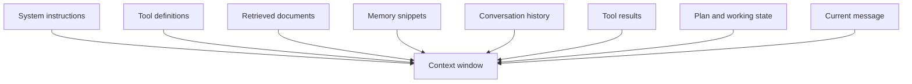

# Context engineering

## Learning objectives

After this chapter, you can:

- explain why the context window is a scarce resource even when it is large;
- separate conversation history, working state, and long-term knowledge;
- choose between tool-result clearing, compaction, note-taking, sub-agents, and just-in-time retrieval; and
- write a compaction summary that preserves what matters.

## Mental model

> Context engineering is choosing the smallest set of high-signal tokens for each model call.

The model is stateless. Every call sees only what the application sends. As a context grows, attention is spread across more tokens and quality tends to decline—an effect practitioners call *context rot* ([Anthropic, Effective context engineering for AI agents](https://www.anthropic.com/engineering/effective-context-engineering-for-ai-agents)).



Each of these sources competes for the same window. Context engineering decides how much each gets on every call.

## Why this exists

[Prompt engineering](../prompting/prompt-engineering.md) designs one prompt. An agent assembles a new context on every step from many sources, and without discipline the history grows until cost rises, latency rises, and the model loses track of what matters.

## Conversation history, working state, and long-term knowledge

| | Conversation history | Working state | Long-term knowledge |
| --- | --- | --- | --- |
| Purpose | Record of this session's turns | Progress on the current task | Reusable facts, preferences, procedures |
| Examples | Messages, tool calls, tool results | Plan, completed steps, IDs of created resources, budget used | Documents, policies, user preferences |
| Shape | Unstructured transcript | Structured and typed | Text, documents, key-value records |
| Owner | Thread store | Orchestrator code | Retrieval and memory services |
| Lifetime | One thread | One run | Indefinite |

Keep working state **structured and outside the transcript**. Do not make the model re-derive "which refunds have I issued?" from forty messages; keep the answer in state and render it into the prompt.

```python
from pydantic import BaseModel


class SideEffectRecord(BaseModel):
    key: str
    status: str
    result: dict | None = None


class TaskState(BaseModel):
    goal: str
    plan: list[str]
    completed_steps: list[str] = []
    artifacts: dict[str, str] = {}          # for example {"ticket": "AI-1234"}
    side_effects: list[SideEffectRecord] = []
    budget_used_usd: float = 0.0
```

Durable, cross-session memory is covered in [durable memory](durable-memory.md).

## Techniques for keeping context small

| Technique | How | Trade-off |
| --- | --- | --- |
| Tool-result clearing | Replace old, bulky tool output with a short stub such as "search_logs result removed; 312 lines" | Cheap and safe; the model can call the tool again |
| Sliding window | Keep only the last *n* turns | Loses early instructions and decisions |
| Compaction | When the context nears its limit, summarize the transcript into a dense note and continue from the note plus recent turns | Lossy; quality depends on the summary |
| Hierarchical summaries | Summaries of summaries for very long runs | More moving parts |
| Structured note-taking | The agent maintains a notes or to-do file outside the context and re-reads it | Survives compaction and restarts |
| Sub-agents | Delegate a sub-task to a fresh context and receive a condensed result | Keeps the main context clean; costs more tokens in total |
| Just-in-time retrieval | Keep references—file paths, IDs, URLs—in context and load content only when needed | Requires good tools |

Anthropic's API offers first-party versions of memory, compaction, and tool-result clearing; its [context-engineering cookbook](https://platform.claude.com/cookbook/tool-use-context-engineering-context-engineering-tools) compares them.

### What a compaction summary must keep

- the user's goal and constraints;
- decisions made and why;
- current state: identifiers, files changed, resources created;
- unresolved problems; and
- next steps.

Discard redundant tool output and the detail of dead ends, but keep a one-line note that each dead end was ruled out, or the agent may try it again.

### Compaction and prompt caching

Prompt caching rewards an unchanged prefix (see [LLM fundamentals](../foundations/llm-fundamentals.md#inference-mechanics-prefill-decode-and-the-kv-cache)). Compaction rewrites history and invalidates the cache from that point, so compacting too eagerly can increase cost. Many practitioners trigger compaction when the window is roughly 70–80% full; treat that as a starting heuristic and tune it with evaluation.

## Common misconceptions

- **Misconception:** A bigger context window removes the need for context management.
  **Correction:** Cost, latency, and context rot all grow with context size.
- **Misconception:** The transcript is the agent's state.
  **Correction:** The transcript is a log. State that code depends on should be structured and stored separately.

## Production considerations

- Measure context size per step and alert on runaway growth.
- Evaluate task success with and without compaction before enabling it.
- Keep stable content first to preserve cache hits.
- Log compaction summaries so a failed run can be understood later.

## Interview questions

1. What belongs in working state rather than in the transcript?
   <details><summary>Answer</summary>Anything code relies on: the plan, completed steps, identifiers of created resources, side-effect records, and budget used. The transcript is an unreliable place to recover these.</details>
2. What must a compaction summary preserve?
   <details><summary>Answer</summary>The goal and constraints, decisions and their reasons, current state and identifiers, open problems, next steps, and a note of approaches already ruled out.</details>

## Exercises

1. Instrument an agent to log context size per step. Plot it for ten tasks.
2. Implement tool-result clearing and compaction at 70% of an artificially small limit. Compare task success on ten long tasks with and without each technique.

## References

- Anthropic, [Effective context engineering for AI agents](https://www.anthropic.com/engineering/effective-context-engineering-for-ai-agents)
- Anthropic, [Context engineering cookbook: memory, compaction, and tool clearing](https://platform.claude.com/cookbook/tool-use-context-engineering-context-engineering-tools)
- Packer et al., [MemGPT: Towards LLMs as Operating Systems (2023)](https://arxiv.org/abs/2310.08560)
