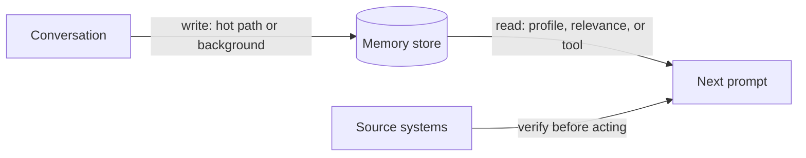

# Durable memory

## Learning objectives

After this chapter, you can:

- distinguish semantic, episodic, and procedural memory;
- choose when and how memory is written and read;
- handle stale and conflicting memories with explicit rules; and
- prevent untrusted content from becoming persistent instructions.

## Mental model

> Memory is a cache of the world: useful, scoped, dated, and never the source of truth.

The model remembers nothing between calls. "Memory" is always the application choosing what to put back into a future prompt.

## Why this exists

Users expect an assistant to remember preferences and past work, and agents improve when they can reuse what they learned. Without rules, memory accumulates stale, contradictory, and sometimes malicious entries that quietly steer future behavior.

## Conversation history versus durable memory

| | Conversation history | Durable memory |
| --- | --- | --- |
| What | Raw messages in the current session | Facts, preferences, and lessons kept across sessions |
| Lifetime | One thread | Weeks or longer |
| Storage | The request and a thread store | Database, vector store, files, or graph |
| Growth | Every turn | Curated: written, updated, and deleted |
| Example | "The user asked for Q3 numbers; I ran query X" | "The user prefers metric units" |

## Types of memory

The [CoALA](https://arxiv.org/abs/2309.02427) framework borrows categories from cognitive science:

- **Semantic:** facts—"Alice owns the account."
- **Episodic:** experiences—"Last time this job failed, a full refresh fixed it."
- **Procedural:** how to act—system instructions, skills, learned rules.

## Writing memory

- **Hot path:** the agent calls a `remember` tool during the conversation. Immediate, but adds latency and can store noise.
- **Background:** a separate process extracts and merges memories after the session. Cleaner, but delayed.

Store each memory with its source, creation time, confidence, scope (user, tenant, or global), and time to live.

## Reading memory

- An always-loaded profile: a small, curated document such as a user profile.
- Retrieval by relevance: RAG over memories.
- Agent-initiated search: a `search_memory` tool used when needed.

## Stale, conflicting, and untrusted memory

### Stale

- Timestamp every memory and show its age to the model.
- Set a time to live per type: long for preferences, hours for "who is on call."
- **Verify before acting.** If memory says a file contains a function, read the file first. The source system is authoritative.

### Conflicting

- Encode a resolution policy in code: newer beats older; authoritative sources beat inferences; user statements beat model inferences; tenant policy beats user preference where required.
- On write, detect contradictions and supersede the old entry rather than appending, keeping history for audit.
- When a conflict cannot be resolved, surface it to the model or user instead of choosing silently.

### Untrusted

- Memory derived from tool output, web pages, email, or other users is untrusted. Because it persists, an injected instruction stored as memory keeps acting in later sessions—*memory poisoning*.
- Record provenance (`user`, `tool:web`, `agent-inferred`) and a trust level. Render untrusted memory as quoted data, never as instructions.
- Scope memory strictly by user and tenant (see [multi-tenant RAG](../rag/multi-tenant-rag.md)).
- Let users view, edit, and delete what is remembered about them; data-protection law often requires it.

## Common misconceptions

- **Misconception:** More memory makes an agent smarter.
  **Correction:** Unrevised memory becomes outdated and contradictory. Curation matters more than volume.
- **Misconception:** Memory written by the agent itself is trustworthy.
  **Correction:** It may have been derived from untrusted content. Provenance decides trust.

## Production considerations

- Keep memory stores tenant-scoped and auditable.
- Add memory-poisoning cases to the security test suite.
- Measure whether memory improves task success; remove memory types that do not.

## Interview questions

1. A memory says "the user's manager is Bob" and is six months old. An HR tool says "Carol." What does the system do?
   

Answer
Trust the authoritative, current source (the HR tool), supersede the stale memory while keeping it in history, and record the source of the new value.

2. How can a web page attack future sessions through memory?
   

Answer
Injected text is saved as a memory and later loaded into a prompt as if it were trusted guidance. Prevent it with provenance tags, trust levels, rendering untrusted memory as data, and review of what is written.

## Exercises

1. Implement `remember` and `recall` tools that store provenance, scope, and timestamps.
2. Write a test in which a retrieved web page tries to plant a malicious memory, and show that it cannot become an instruction.

## References

- Sumers et al., [Cognitive Architectures for Language Agents (CoALA, 2023)](https://arxiv.org/abs/2309.02427)
- LangChain, [Memory concepts](https://docs.langchain.com/oss/python/concepts/memory)
- Packer et al., [MemGPT (2023)](https://arxiv.org/abs/2310.08560)
