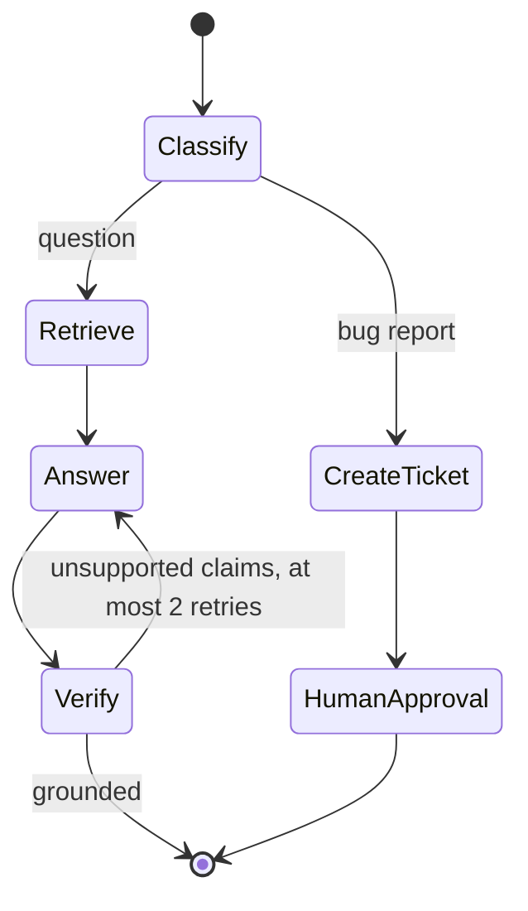

# Planning

## Learning objectives

After this chapter, you can:

- distinguish a workflow from an agent and choose the simpler one that works;
- recognize the common workflow patterns;
- compare reactive (ReAct) execution with plan-then-execute; and
- express control flow as an explicit graph with typed state.

## Mental model

> Put deterministic control flow in code and judgment in model calls. Move control to the model only where the next step genuinely cannot be predicted.

## Why this exists

A model can choose its own next step, but each choice adds latency, cost, and a chance of error. Planning is the design decision about *who* sequences the work—code or model—and how much is decided in advance.

## Workflows versus agents

Anthropic's [Building effective agents](https://www.anthropic.com/research/building-effective-agents) separates two kinds of agentic system:

- **Workflows:** models and tools orchestrated through predefined code paths.
- **Agents:** the model dynamically directs its own process and tool use.

Start with the simplest option: a single well-prompted call with retrieval, then a workflow, then an agent only when the number and order of steps cannot be known in advance.

### Workflow patterns

| Pattern | Shape | Use when |
| --- | --- | --- |
| Prompt chaining | A fixed sequence of calls, each consuming the previous output, with checks between them | The task splits cleanly into ordered steps |
| Routing | Classify the input, then send it to a specialized path | Distinct input types need different handling |
| Parallelization | Run independent sub-tasks or several attempts at once, then combine | Sub-tasks are independent, or voting improves confidence |
| Orchestrator–workers | A model splits the task dynamically and delegates to workers, then synthesizes | Sub-tasks cannot be known in advance |
| Evaluator–optimizer | One call generates, another critiques, repeat | Clear evaluation criteria exist and iteration helps |

## Reactive versus plan-then-execute

| | Reactive (ReAct) | Plan-then-execute |
| --- | --- | --- |
| How | Decide one step at a time from the latest observation | Produce a full plan, then execute its steps, optionally re-planning |
| Strengths | Adapts to surprises; simple | Fewer model calls; the plan can be reviewed or approved; steps can run in parallel or on cheaper models |
| Weaknesses | Can wander; myopic; many calls | Brittle when reality differs from the plan |
| Use when | Exploration, debugging, unfamiliar environments | Well-understood multi-step tasks; human sign-off required |

ReAct ([Yao et al., 2022](https://arxiv.org/abs/2210.03629)) interleaves reasoning and acting: think, call a tool, observe, repeat. Modern models do this natively through tool calling.

Hybrids are common in practice:

- **Plan, execute, re-plan** after each step or after a failure.
- **Orchestrator–workers** with sub-agents (see [multi-agent systems](../agents/multi-agent-systems.md)).
- **Reflection:** generate, critique, revise—as in Reflexion ([Shinn et al., 2023](https://arxiv.org/abs/2303.11366)).
- **A to-do list as state:** the agent keeps an explicit checklist in context and updates it. Cheap and effective for long tasks.

## Graphs and state machines

Free-form loops are hard to test and resume. Graph orchestration makes control flow explicit:

- **Nodes** are steps: a model call, a tool call, a human review, or a pure function.
- **Edges** are transitions, possibly conditional on state.
- **State** is a typed object that nodes read and update.
- **Checkpoints** after each node enable resume, inspection, and human-in-the-loop pauses (see [checkpointing and recovery](../memory/checkpointing-and-recovery.md)).



The classification and verification edges are deterministic code; the model is used only inside nodes that need judgment.

## Minimal example

A LangGraph-style sketch of the retrieve-answer-verify loop:

```python
from typing import TypedDict

from langgraph.graph import END, StateGraph


class State(TypedDict):
    question: str
    docs: list
    answer: str
    grounded: bool
    attempts: int


graph = StateGraph(State)
graph.add_node("retrieve", retrieve)
graph.add_node("answer", answer)
graph.add_node("verify", verify)
graph.set_entry_point("retrieve")
graph.add_edge("retrieve", "answer")
graph.add_edge("answer", "verify")
graph.add_conditional_edges(
    "verify",
    lambda s: END if s["grounded"] or s["attempts"] >= 2 else "answer",
)
app = graph.compile(checkpointer=checkpointer)
```

`retrieve`, `answer`, `verify`, and `checkpointer` are placeholders. The point is that the retry limit and exit condition live in code, not in the prompt.

As of October 2026, frameworks in this space include LangGraph, the OpenAI Agents SDK, the Claude Agent SDK, Google's Agent Development Kit, CrewAI, Pydantic AI, AutoGen, and LlamaIndex Workflows. Durable-execution engines such as Temporal, Restate, Inngest, and DBOS provide production-grade retries and resumption underneath any of them.

## Common misconceptions

- **Misconception:** An agent is more advanced than a workflow, so it is the better default.
  **Correction:** An agent trades predictability, latency, and cost for flexibility. Use one only when the flexibility is needed.
- **Misconception:** A plan produced by the model is a commitment.
  **Correction:** It is a proposal. Validate it, bound it, and re-plan when observations contradict it.

## Production considerations

- The more control flow is explicit, the more of the system can be unit-tested.
- Plans are a natural approval point for high-impact work.
- Track re-planning frequency; frequent re-plans suggest the task is poorly suited to planning upfront.

## Interview questions

1. When is plan-then-execute better than ReAct, and when is it worse?
   <details><summary>Answer</summary>Better for well-understood multi-step tasks where a reviewable plan, fewer model calls, or parallel execution matter. Worse in unfamiliar environments where observations frequently invalidate the plan.</details>
2. What is the difference between a workflow and an agent, and why start with a workflow?
   <details><summary>Answer</summary>A workflow follows code-defined paths; an agent chooses its own steps. Workflows are cheaper, faster, and easier to test and debug, so use an agent only when the step sequence cannot be predicted.</details>

## Exercises

1. Take a task you would solve with an agent and express it as a workflow. Note which steps genuinely need model choice.
2. Implement the retrieve-answer-verify graph above and test its exit conditions without calling a model.

## References

- Anthropic, [Building effective agents](https://www.anthropic.com/research/building-effective-agents)
- Yao et al., [ReAct: Synergizing Reasoning and Acting in Language Models (2022)](https://arxiv.org/abs/2210.03629)
- Shinn et al., [Reflexion: Language Agents with Verbal Reinforcement Learning (2023)](https://arxiv.org/abs/2303.11366)
- LangGraph, [Overview](https://docs.langchain.com/oss/python/langgraph/overview)
