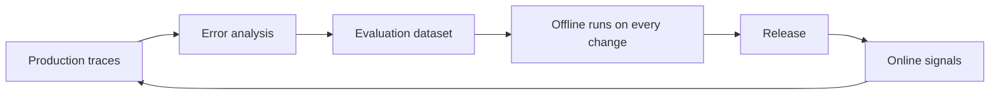

# Evaluation

Evaluation turns "this seems better" into an engineering decision. A useful suite contains representative requests, difficult edge cases, and every important production failure that should not recur.

## Learning objectives

After this chapter, you can:

- build an evaluation dataset from error analysis rather than guesswork;
- choose between code, model, human, and environment-state graders;
- report pass@k and pass^k for non-deterministic agents;
- define tool-level and end-to-end metrics; and
- connect offline evaluation to online signals.

## Mental model

> An evaluation suite is the regression test suite for a probabilistic system.

Failures found in production become test cases, so the suite grows toward the failures that actually matter.

## Evaluation stack

| Layer | Purpose |
| --- | --- |
| Deterministic checks | Validate schemas, citations, permissions, and invariants |
| Task metrics | Measure correctness against labels or executable outcomes |
| Rubric grading | Score qualities such as completeness or tone |
| Human review | Resolve ambiguity and calibrate automated graders |
| Online signals | Observe real behavior, including latency, cost, and user success |

Pin model and prompt versions, record evaluation inputs, and compare changes against the same dataset. Treat model-based graders as measurement instruments: calibrate them against human judgment and test for bias.

## Building the offline dataset

1. **Start with error analysis, not metrics.** Read 50–100 real traces, note what went wrong, and group failures into categories. Hamel Husain and Shreya Shankar describe this practice in the [evals FAQ](https://hamel.dev/blog/posts/evals-faq/).
2. **Seed from reality.** Sample anonymized production inputs, then add hand-written edge cases and adversarial cases: prompt injection, out-of-scope requests, ambiguity.
3. **Add every production bug** as a new case.
4. **Prefer quality to size.** Early on, 50–200 well-labeled cases are worth more than thousands of noisy ones.

## Graders

| Grader | Use for | Notes |
| --- | --- | --- |
| Code | Exact match, schema validity, query runs, tests pass, correct tool chosen | Cheapest and most reliable; prefer whenever possible |
| Model as judge | Faithfulness, tone, helpfulness, rubric adherence | Calibrate against human labels. Binary pass or fail with a written rubric is more reliable than a 1–10 score. Watch for position, verbosity, and self-preference bias |
| Human | Gold labels and ambiguous domains | Expensive; use it to calibrate the others |
| Environment state | Agent tasks: did the database end up correct? | The strongest signal for agents |

## Repeated runs: pass@k and pass^k

Agents are non-deterministic, so run each case *k* times:

- **pass@k:** succeeded at least once in *k* attempts—a measure of capability.
- **pass^k:** succeeded in all *k* attempts—a measure of reliability, which is what production needs.

The τ-bench benchmark ([Yao et al., 2024](https://arxiv.org/abs/2406.12045)) introduced pass^k for tool-using agents and showed that reliability falls sharply as *k* grows even when single-run success looks acceptable.

## Tool-level and end-to-end metrics

End-to-end metrics tell you *whether* the system works; tool-level metrics tell you *where* it breaks.

| Tool or step metric | Definition |
| --- | --- |
| Tool-selection accuracy | The correct tool was chosen for the step |
| Argument accuracy | Arguments were valid and correct |
| Tool error rate | Share of calls returning schema, authorization, or downstream errors |
| Self-correction rate | How often the model had to fix its own call |
| Tool latency | p50 and p95 per tool |
| Unnecessary calls | Calls that did not contribute to the outcome |

| End-to-end metric | Definition |
| --- | --- |
| Task success rate | The goal was achieved, verified by state or a grader |
| pass^k | Reliability across repeated runs |
| Steps, tokens, and cost per successful task | Efficiency; cost per *success* is the honest number |
| Wall-clock latency | p50 and p95 per task |
| Human-intervention rate | How often a person had to step in |
| Harmful or incorrect action rate | Actions that should not have happened—the safety metric |
| Policy violation rate | Guardrail breaches |

Also evaluate the **trajectory**, not only the final answer. An agent can reach the right result by a dangerous path, such as deleting and recreating a record.

Public benchmarks worth knowing include SWE-bench (coding), τ-bench and τ²-bench (tool-using customer service), GAIA, WebArena, OSWorld, and the Berkeley Function-Calling Leaderboard. They indicate general capability; they do not replace an evaluation on your own tasks.

## Online evaluation

- **Implicit signals:** ratings, regenerations, edits to drafts, escalations, abandonment, and task completion.
- **Sampled model grading** of live traces for groundedness and policy violations.
- **Guardrail metrics:** block rates and injection detections.
- **A/B tests and canaries** for prompt and model changes, with guardrail metrics as stop conditions.
- **Drift:** new topics, languages, or input shapes, and scores declining over time.

Feed online failures back into the offline dataset.

## Common misconceptions

- **Misconception:** A high average score means the system is ready.
  **Correction:** Reliability across repeats and the rate of harmful actions matter more for consequential systems.
- **Misconception:** A model judge is objective.
  **Correction:** It is an instrument with biases. Calibrate it against people and re-check when the judge model changes.

## Production considerations

- Run the offline suite on every change to prompts, models, tools, retrieval, or orchestration.
- Store evaluation datasets with the same tenant and privacy controls as production data.
- Version the dataset; a changed dataset makes historical comparisons invalid.

## Interview questions

1. Why is pass^k a better launch metric than single-run success for agents?
   

Answer
Users experience every run, not the best one. pass^k measures whether the agent succeeds consistently, which exposes unreliability that a single-run or best-of-k score hides.

2. How do you trust a model-as-judge grader?
   

Answer
Label a sample by hand, measure agreement with the judge, refine the rubric until agreement is acceptable, test for known biases, and re-calibrate when the judge model or rubric changes.

## Exercises

1. Read 50 traces from a system you own and write down a failure taxonomy before choosing any metric.
2. Build a 50-case suite with code graders and one calibrated model judge. Run each case five times and report pass^5.

## References

- Hamel Husain and Shreya Shankar, [Evals FAQ](https://hamel.dev/blog/posts/evals-faq/)
- Hamel Husain, [Your AI product needs evals](https://hamel.dev/blog/posts/evals/)
- Anthropic, [Demystifying evals for AI agents](https://www.anthropic.com/engineering/demystifying-evals-for-ai-agents)
- Yao et al., [τ-bench (2024)](https://arxiv.org/abs/2406.12045)
- Eugene Yan, [Patterns for building LLM-based systems and products](https://eugeneyan.com/writing/llm-patterns/)
