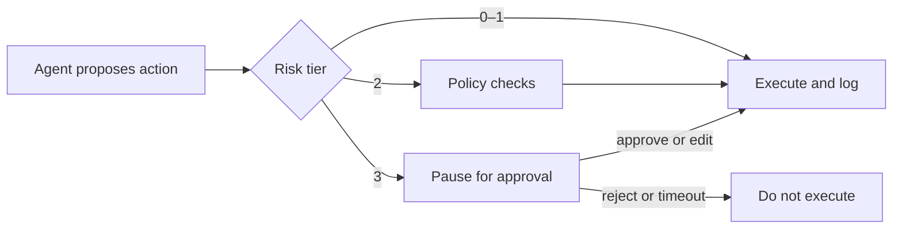

# Human approval

## Learning objectives

After this chapter, you can:

- tier actions by reversibility, blast radius, and cost;
- design an approval step that people can evaluate quickly and correctly;
- bind an approval to the exact action approved; and
- use approval metrics to decide when to widen autonomy.

## Mental model

> Ask a person only where a mistake is expensive, and show them exactly what will happen.

## Why this exists

Some actions cannot be undone: payments, deletions, external messages, production changes. Approval is the last control before them. Too many approval requests produce fatigue, and fatigued reviewers approve without reading, so approval must be reserved for the actions that need it.

## Risk tiers

| Tier | Examples | Control |
| --- | --- | --- |
| 0: read-only | Search, read documents, scoped queries | Autonomous |
| 1: reversible, low impact | Draft an email, create a ticket, write to a sandbox | Autonomous, logged, with undo |
| 2: reversible, higher impact | Update customer records, merge to a non-production branch | Policy checks and sampled review |
| 3: irreversible or high impact | Payments, refunds above a threshold, deleting data, external communication, production deployments, permission changes | Explicit approval, or a two-person rule |

## Designing the approval step

- Show **exactly** what will execute—the diff, amount, recipient—with the agent's reasoning and the sources it relied on. "The agent wants to call `refund`" is not reviewable.
- Allow approve, edit, and reject; edits flow back into the run's state.
- **Bind the approval to the action:** store a hash of the approved arguments and verify it at execution time, so an approved refund of ₹500 cannot execute as ₹50,000.
- Implement approval as a durable interrupt so the run can wait for hours or days (see [checkpointing and recovery](../memory/checkpointing-and-recovery.md#human-in-the-loop-interrupts)).
- Treat a timeout as a rejection.

## Approval metrics

Track the approval rate, edit rate, and time to approve per action type. An action type approved without edits for a long period is a candidate for policy-based automation; a high edit rate shows where the agent needs improvement.

## Common misconceptions

- **Misconception:** Requiring approval for everything is the safest design.
  **Correction:** It produces fatigue and rubber-stamping. Tier the actions.
- **Misconception:** A person approving makes the action safe.
  **Correction:** Only if the approval screen shows enough to judge it and the approval is bound to what executes.

## Production considerations

- Record who approved what, when, and what they saw.
- Route approvals to people with the authority and context to decide.
- Exercise the reject and timeout paths in tests.

## Interview questions

1. Which actions in a system you know would you place in tier 3, and why?
   

Answer
A strong answer names concrete actions, explains their irreversibility or blast radius, and states the approval data the reviewer must see—not just "anything that writes."

## Exercises

1. Add a tier-3 tool to an agent with a durable approval interrupt bound to a hash of its arguments. Test approve, edit, reject, and timeout.

## References

- LangGraph, [Durable execution](https://docs.langchain.com/oss/python/langgraph/durable-execution)
- OWASP, [Top 10 for LLM Applications 2025](https://genai.owasp.org/llm-top-10/) (LLM06: Excessive Agency)
