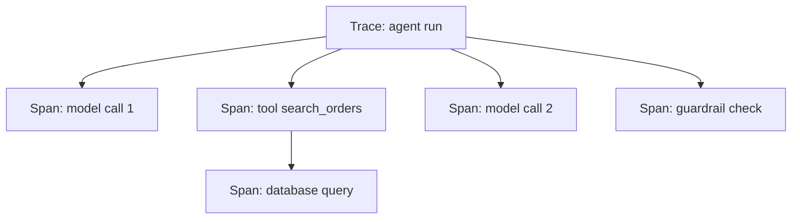

# Observability

## Learning objectives

After this chapter, you can:

- model an agent run as a trace of nested spans;
- decide what to capture so a failing step can be replayed exactly;
- use vendor-neutral attribute names; and
- debug a multi-step run by locating the first wrong decision.

## Mental model

> If you cannot replay a step with its exact inputs, you cannot debug it.



A trace is one run; spans are its model calls, tool calls, retrievals, and checks, nested by parent and child.

## Why this exists

A wrong final answer is usually caused several steps earlier: a retrieval miss, a misleading tool result, a lost constraint after compaction. Logs of the final output alone cannot show where the run went wrong.

## What to capture

For every span: full inputs (including system instructions and tool definitions), outputs, model and version, parameters, token counts, cost, latency, errors and retries, tool arguments and results, user, tenant, and session identifiers, prompt version, and code version.

The [OpenTelemetry GenAI semantic conventions](https://opentelemetry.io/docs/specs/semconv/gen-ai/) define vendor-neutral attribute names such as `gen_ai.request.model` and `gen_ai.usage.input_tokens`, so traces can move between backends.

```python
from opentelemetry import trace

tracer = trace.get_tracer("agent")

with tracer.start_as_current_span("tool.search_orders") as span:
    span.set_attribute("gen_ai.tool.name", "search_orders")
    span.set_attribute("tenant.id", ctx.tenant_id)
    result = search_orders(**args)
    span.set_attribute("tool.result_count", len(result))
```

As of October 2026, tracing platforms for model applications include Langfuse, LangSmith, Arize Phoenix, Braintrust, Helicone, and Weights & Biases Weave; general observability backends such as Datadog, SigNoz, and Honeycomb accept the same data through OpenTelemetry.

## Debugging workflow

1. Find the failing trace from a user report, evaluation failure, or alert.
2. Walk the steps and locate the **first** wrong decision; the visible error is usually downstream of it.
3. Classify it: retrieval miss, wrong tool, wrong arguments, tool bug, misleading tool output, context lost to compaction, or prompt injection.
4. **Replay** the step with the exact recorded inputs and iterate on the fix.
5. Add the case to the evaluation dataset (see [evaluation](evaluation.md)).

## Common misconceptions

- **Misconception:** Logging the final prompt and answer is enough.
  **Correction:** Multi-step failures need every intermediate step, with parent-child structure.

## Production considerations

- Redact personal data and secrets before traces leave the process.
- Scope trace access by tenant, and set a retention period.
- Sample high-volume, low-risk traffic; keep every trace for high-risk actions.
- Alert on anomalies: unusual tool sequences, cost spikes, rising error rates.

## Interview questions

1. What must a trace contain so a failing step can be replayed exactly?
   <details><summary>Answer</summary>The complete model input—system instructions, tool definitions, messages, retrieved context—plus model version and parameters, and the exact tool arguments and results at that step.</details>

## Exercises

1. Instrument an agent with OpenTelemetry or a tracing platform, recording tokens, cost, and tenant for every model and tool call.
2. Take one failed run and identify the first wrong decision using only the trace.

## References

- OpenTelemetry, [Semantic conventions for generative AI](https://opentelemetry.io/docs/specs/semconv/gen-ai/)
