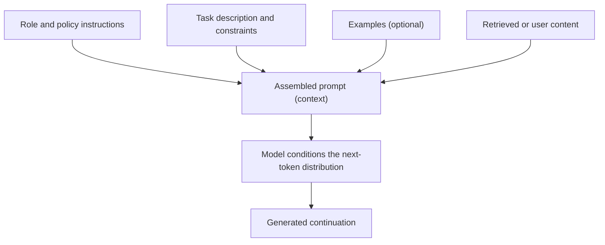

# Prompt engineering and in-context learning

## Learning objectives

After this chapter, you can:

- explain why a prompt changes model behavior without changing model weights;
- describe how roles, instructions, and examples condition the next-token distribution;
- distinguish zero-shot, one-shot, and few-shot prompting and know when examples hurt;
- treat a prompt as a versioned interface contract rather than an incantation; and
- decide which work belongs in the prompt and which belongs in deterministic code or tools.

## The governing mental model

> A prompt is context, not a command.

From [LLM fundamentals](../foundations/llm-fundamentals.md), the model only ever predicts the next token from its context. A prompt does not instruct a program that follows rules; it supplies the context that reshapes the probability distribution over continuations. The weights are fixed at inference time. Everything a prompt achieves, it achieves by *conditioning* generation, not by reprogramming the model.

This reframing matters: "the model ignored my instruction" is usually "my context did not make the desired continuation the most probable one." The lever is the context, not stronger wording.

## How a prompt conditions generation

Each part of the prompt shifts probability mass toward some continuations and away from others. The skill of prompt engineering is arranging context so the desired output becomes the most probable one, reliably, across the inputs you expect.

## Roles and personas narrow the distribution

Telling a model "You are an experienced CTO" works, but not because the model *becomes* a CTO. The phrase conditions generation on the regions of the training distribution statistically associated with that role, narrowing plausible continuations toward that vocabulary, framing, and level of detail.

This explains both the power and the limits of personas:

- A role is a cheap, coarse control over tone, depth, and framing.
- It does not add knowledge the model never learned, and it does not enforce anything. A persona makes an output *more likely*, not *guaranteed*.

Use roles to set framing; use structure and validation for guarantees.

## In-context learning: zero-, one-, and few-shot

In-context learning is the model's ability to adapt its behavior from examples placed in the prompt, without any weight update. The examples do not teach new facts; they demonstrate the pattern, format, and mapping you want applied to pretrained knowledge.

- **Zero-shot:** describe the task; rely on pretrained ability. Cheapest; best when the task is common and the output shape is simple.
- **One-shot:** add a single example. Useful mainly to pin down an ambiguous output format.
- **Few-shot:** add several examples that demonstrate the input-to-output pattern. Useful when the format is specific, the task is unusual, or edge-case handling must be shown rather than described.

Examples are context like everything else: they consume tokens, add latency and cost, and steer the distribution.

## When examples hurt

More examples are not monotonically better. Poorly chosen or excessive examples can *over-constrain* the model: it latches onto superficial patterns in the examples—their length, phrasing, or ordering—instead of the underlying task, and generalizes worse on inputs that differ from the samples.

Practical consequences:

- Choose examples that are representative and diverse, not near-duplicates.
- Show the hard and edge cases you actually care about.
- Add examples only when they improve *measured* performance, and stop when they stop helping.

## A prompt is an interface contract

A production prompt is an interface contract. It should state the task, relevant context, constraints, and output shape clearly enough to test and version.

A durable pattern:

1. Put stable role and policy instructions first.
2. Separate trusted instructions from untrusted user or retrieved content.
3. Specify the output schema and the behavior for missing or ambiguous information.
4. Include examples only when they improve measured performance.
5. Version the prompt with the code and evaluation results it affects.

Treat the prompt as a tested artifact: it has inputs, an expected output contract, and a regression suite. Phrasing that "seems better" is a hypothesis until an evaluation confirms it.

## Push deterministic work to tools

An LLM is a pattern predictor, not a calculator, database, or rule engine. Coaxing exact arithmetic, precise SQL, or strict policy enforcement out of clever wording is fighting the mechanism: the model produces a *plausible-looking* answer, which is not the same as a *correct* one.

For anything that must be exact, deterministic, or auditable—math, lookups, transactions, permission checks, business rules—do it in code or a tool and give the result back to the model as context. Prompting decides *what* to do and *how to phrase it*; deterministic code guarantees *correctness*. Avoid relying on phrasing alone for hard guarantees: enforce permissions, schemas, ranges, and business rules in deterministic code.

## Common misconceptions

- **A prompt reprograms the model.** It only supplies context; weights are fixed. It changes probabilities, not the program.
- **A persona gives the model new knowledge or authority.** It narrows framing toward an associated region of the distribution; it does not add facts or enforce rules.
- **More examples always help.** Excess or unrepresentative examples over-constrain the model and can reduce generalization.
- **Stronger wording yields hard guarantees.** Phrasing shifts likelihood, not certainty; guarantees come from schemas, validation, and code.
- **Better prompts fix arithmetic and exact lookups.** Deterministic tasks belong in tools; the model should consume their results, not simulate them.

## Production considerations

- Version prompts alongside code, and tie each version to its evaluation results.
- Keep trusted instructions and untrusted content clearly separated to reduce prompt-injection risk.
- Measure prompt changes against a representative evaluation set; treat "it feels better" as a hypothesis.
- Account for the token, latency, and cost impact of examples and long context.
- Enforce output structure with schemas and validators rather than relying on wording.
- Log the prompt version, inputs, and outputs needed to reproduce and debug behavior.

## Interview-ready answers

### Why does a prompt change behavior if the weights are fixed?

The model always predicts the next token from its context. A prompt supplies that context and reshapes the probability distribution over continuations. It conditions generation rather than modifying the model.

### Why does assigning a role or persona work?

The role conditions generation on regions of the training distribution associated with that role, narrowing plausible continuations toward the corresponding tone, framing, and detail. It makes desired output more likely; it does not add knowledge or enforce rules.

### What is in-context learning, and how is it different from training?

In-context learning is adapting behavior from examples in the prompt at inference time, with no weight updates. Training changes weights; in-context learning only changes the context the fixed model conditions on.

### When can few-shot examples make results worse?

When examples are unrepresentative, redundant, or too numerous, the model can fixate on superficial patterns—length, phrasing, order—and generalize worse on inputs that differ from the samples.

### Which tasks should not be solved by prompting alone?

Anything requiring exactness or auditability—arithmetic, precise SQL, lookups, permission checks, business rules. Handle these in deterministic code or tools and pass the result to the model as context.

## Exercises

1. Take one weak instruction-style prompt and rewrite it as an interface contract: task, constraints, output schema, and behavior for missing information.
2. For a small classification task, compare zero-shot, one-shot, and few-shot on the same inputs and record where added examples stop helping.
3. Construct a few-shot prompt whose examples are deliberately unrepresentative and observe how outputs over-fit their surface features.
4. Take a task that mixes reasoning and exact computation, and redesign it so the model orchestrates while a tool performs the deterministic step.

## Learning journal

The [Module 2 Q&A and insights](prompt-engineering-qa.md) preserve the original answers, corrections, and questions to revisit.
