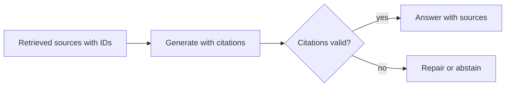

# Grounding and evaluation

## Learning objectives

After this chapter, you can:

- write a grounded prompt that requires citations and permits abstention;
- verify citations in code;
- build a retrieval evaluation set and compute recall, precision, MRR, and nDCG; and
- evaluate generated answers for faithfulness, relevance, and abstention.

## Mental model

> Every claim should trace to a retrieved source, and "not found" is a correct answer when it is true.



## Why this exists

Retrieval puts evidence in front of the model, but the model can still ignore it, blend it with prior knowledge, or cite the wrong passage. Grounding makes answers checkable; evaluation tells you whether retrieval, generation, or both need work.

## Grounding and citations

```text
Answer only from the sources below. Each source has an ID.
Cite every claim like [S2]. If the sources do not contain the answer, reply
"I couldn't find this in the available documents." Do not use outside knowledge.

<sources>
<source id="S1" title="Refund policy v3" updated="2026-05-01">...</source>
<source id="S2" title="EU addendum" updated="2026-08-12">...</source>
</sources>

Question: ...
```

- Use stable source IDs and map them to titles, URLs, and page numbers in the interface.
- **Verify citations in code:** every cited ID must be in the retrieved set. Optionally check that quoted spans actually appear in the source. Some provider APIs return citations tied to exact source spans.
- **Reward abstention.** A system that says "not found" when the evidence is missing is behaving correctly.
- Put the question after the documents, and place the most relevant passages at the start or end of the evidence block, where models use them most reliably.

## Evaluating retrieval

Build a golden set of 100–500 realistic questions, each labeled with the chunk or document IDs that answer it. Mine questions from real usage where possible; model-generated questions are acceptable if a person reviews them.

| Metric | Measures |
| --- | --- |
| Recall at *k* | Whether a relevant chunk appears in the top *k*; the most important RAG metric because the model cannot use what it never sees |
| Precision at *k* | How much of the top *k* is relevant |
| Mean reciprocal rank (MRR) | How high the first relevant result ranks |
| nDCG at *k* | Ranking quality with graded relevance and a discount for lower positions |

Also measure freshness and permission correctness, as described in [retrieval-augmented generation](retrieval-augmented-generation.md#evaluate-retrieval-and-generation-separately).

## Evaluating generation

| Metric | Question |
| --- | --- |
| Faithfulness (groundedness) | Is every claim supported by the retrieved context? |
| Answer relevance | Does the answer address the question? |
| Context relevance | Was the retrieved context on topic? |
| Correctness | Does it match the reference answer? |
| Citation accuracy | Does each citation support the claim it is attached to? |
| Abstention quality | Does it say "not found" when, and only when, the answer is absent? |

Model-based graders are acceptable when calibrated against human labels (see [evaluation](../production/evaluation.md)). As of October 2026, tools include Ragas, DeepEval, TruLens, promptfoo, Arize Phoenix, LangSmith, and Braintrust.

## Hallucination mitigation checklist

1. Improve retrieval first. Most RAG hallucinations are retrieval misses.
2. Prefer fewer, better chunks to many mediocre ones.
3. Place the question after the documents and the strongest evidence at the edges.
4. Instruct the model to answer only from sources and to say when it cannot.
5. Require citations and validate them.
6. Add a verification pass that checks each claim against the sources for high-stakes answers.
7. Show sources in the interface so users can check them.
8. Prefer newer document versions and display their update dates.

## Common misconceptions

- **Misconception:** A citation proves the claim.
  **Correction:** Only if the cited passage actually supports it. Check citation accuracy, not just presence.
- **Misconception:** Abstention is a failure to answer.
  **Correction:** Abstaining when evidence is missing is the correct behavior and should score as a pass.

## Production considerations

- Run the retrieval and generation evaluation suites on every change to chunking, embeddings, ranking, prompts, or models.
- Sample live answers for faithfulness grading and feed failures back into the golden set.
- Track the abstention rate; a sudden rise often signals an ingestion or index problem.

## Interview questions

1. Why is recall at *k* usually the first retrieval metric to optimize in RAG?
   <details><summary>Answer</summary>Because the generator can only use passages it receives. Low recall caps answer quality regardless of prompt or model; precision can then be improved with reranking.</details>

## Exercises

1. Build a 50-question golden set for your corpus with relevant chunk IDs.
2. Write a checker that rejects answers citing IDs not present in the retrieved set.
3. Add ten questions whose answers are absent from the corpus and measure abstention.

## References

- [Ragas documentation](https://docs.ragas.io/)
- Hamel Husain, [Your AI product needs evals](https://hamel.dev/blog/posts/evals/)
- Liu et al., [Lost in the Middle (2023)](https://arxiv.org/abs/2307.03172)
