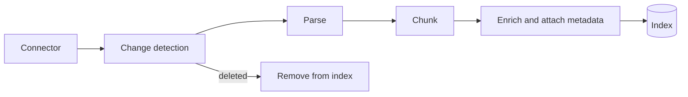

# Ingestion and chunking

## Learning objectives

After this chapter, you can:

- design an incremental ingestion pipeline that handles updates, deletions, and permissions;
- choose a parser for each document type and keep the structure needed for citations;
- choose a chunking strategy and explain its precision and recall trade-off; and
- explain how contextual chunk enrichment improves retrieval.

## Mental model

> Retrieval can only return what ingestion produced. Most RAG quality problems start here.

## Why this exists

Source systems hold documents in formats designed for people: PDFs with columns and footers, slides, tables, HTML with navigation. A retriever needs clean, self-contained text units with metadata. The pipeline that produces them determines the ceiling of retrieval quality.

## Ingestion

- **Connectors** pull from document stores, wikis, ticketing systems, chat, databases, and the web.
- **Incremental sync** records a source identifier, version or entity tag, and update time per document, and re-indexes only what changed.
- **Deletions** must propagate. A document deleted at the source but still retrievable is both a correctness bug and a data leak.
- **Permissions are captured at ingest time**—owners, groups, access lists—alongside content. Retrieval cannot filter on information it never stored (see [multi-tenant RAG](multi-tenant-rag.md)).
- **Deduplication** with content hashes or near-duplicate detection such as MinHash keeps duplicates from crowding out diverse results.

## Parsing

| Source | Challenge | Approach |
| --- | --- | --- |
| PDF | Multi-column layouts, headers, footers, tables, scanned pages | Layout-aware parsers; OCR for scans |
| Tables | Flattening loses row and column meaning | Convert to Markdown or HTML, or to row-wise "column: value" text |
| HTML | Navigation and boilerplate noise | Main-content extraction that keeps headings |
| Slides and images | Text lives inside images | OCR or vision-model descriptions |
| Code | Meaning follows syntax | Split on functions and classes using the syntax tree |

As of October 2026, examples of layout-aware parsing tools include Unstructured, Docling, LlamaParse, and cloud document-intelligence services. Evaluate them on your own documents.

Keep **structure**: heading path, page number, and source location. It improves chunk context and makes precise citations possible.

## Chunking

An embedding represents a whole chunk as one vector, so chunk size trades precision against context:

- chunks that are too small lose context—"it increased by 12%" without saying what increased; and
- chunks that are too large dilute the vector, rank worse, and waste prompt tokens.

| Strategy | How | When |
| --- | --- | --- |
| Fixed size with overlap | Equal token windows with 10–20% overlap | Baseline |
| Recursive or structural | Split on headings, then paragraphs, then sentences | Most documents; a sensible default |
| Semantic | Split where similarity between adjacent sentences drops | Long unstructured prose |
| Document-specific | One function, FAQ entry, or table row per chunk | Code, FAQs, catalogs |
| Parent-child | Retrieve small chunks; give the model their parent section | Precise matching with enough context to answer |
| Contextual enrichment | Prepend a short, model-generated description of where the chunk sits in its document before embedding and keyword indexing | Chunks that are ambiguous out of context |

A reasonable starting point is a few hundred tokens per chunk, split on document structure, with the section title prepended. Tune size and strategy against a retrieval evaluation set (see [grounding and evaluation](grounding-and-evaluation.md)) rather than by intuition.

### Contextual retrieval

Anthropic's [Contextual Retrieval](https://www.anthropic.com/news/contextual-retrieval) generates one or two sentences of document-level context for each chunk and prepends them before both embedding and keyword indexing. In Anthropic's experiments, measured as the share of queries whose relevant chunk was missing from the top 20 results:

- contextual embeddings reduced the failure rate by 35% (5.7% → 3.7%);
- adding contextual keyword (BM25) search reduced it by 49% (5.7% → 2.9%); and
- adding reranking reduced it by 67% (5.7% → 1.9%).

These are the author's benchmark results on its datasets; measure the effect on yours. The enrichment step adds a model call per chunk at indexing time, which prompt caching of the source document makes cheaper.

## Common misconceptions

- **Misconception:** Chunk size is a constant to pick once.
  **Correction:** It depends on document type and query style, and should be tuned with an evaluation set.
- **Misconception:** Ingestion is a one-time import.
  **Correction:** It is a continuously running synchronization that must handle updates, permission changes, and deletions.

## Production considerations

- Track ingestion lag and deletion lag per source as service-level indicators.
- Store a content hash per chunk so unchanged content is not re-embedded.
- Re-index into a new index and switch over when changing chunking or embedding strategy.
- Quarantine documents that fail to parse instead of indexing empty or garbled text.

## Interview questions

1. A user deletes a confidential document, but the assistant still quotes it a day later. What failed, and how do you prevent it?
   

Answer
Deletion propagation in ingestion. Detect deletions at the source (events or periodic reconciliation), remove all chunks for the document, invalidate caches that contain it, and monitor deletion lag.

## Exercises

1. Parse ten real PDFs with two different parsers and compare the extracted text for tables and multi-column pages.
2. Compare fixed-size, structural, and parent-child chunking on the same documents using recall at 5 from a small evaluation set.
3. Add contextual enrichment and measure the change in recall.

## References

- Anthropic, [Introducing Contextual Retrieval](https://www.anthropic.com/news/contextual-retrieval)
- Pinecone, [Chunking strategies for LLM applications](https://www.pinecone.io/learn/chunking-strategies/)
