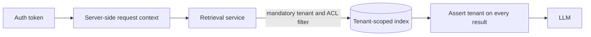

# Multi-tenant RAG

## Learning objectives

After this chapter, you can:

- attach metadata that supports relevance filtering and security filtering;
- explain why access control must filter before ranking, not after;
- compare silo, bridge, and pool isolation models; and
- design a multi-tenant RAG platform where cross-tenant retrieval is structurally impossible.

## Mental model

> The model is never the access-control layer. Whatever reaches the prompt is assumed visible to the user.

Identity comes from authentication, not from the request body or the model. The retrieval service is the only path to the indexes and applies the tenant and document filters itself.

## Why this exists

A shared RAG platform concentrates many customers' documents behind one model. A single missing filter, shared cache, or model-chosen identifier can disclose one customer's data to another—an incident that is hard to detect and impossible to undo.

## Metadata

Store with every chunk: `tenant_id`, `doc_id`, `source`, `section_path`, `page`, `created_at`, `updated_at`, `language`, `doc_type`, allowed principals (users and groups), `classification`, and `embedding_model`.

Metadata serves two different purposes: **relevance** (`doc_type = 'runbook' AND updated_at > now() - interval '1 year'`) and **security**. Only the second is non-negotiable.

## Filter before ranking

- **Post-filtering**—retrieve the top *k*, then drop documents the user may not see—is wrong for security. It can return nothing, leak information through counts and timing, and a single bug exposes data.
- **Pre-filtering**—applying the filter inside the search—is correct. Confirm that your vector engine supports efficient filtered search; very selective filters reduce recall on some engines.

## Document access control

| Approach | How | Notes |
| --- | --- | --- |
| Denormalized access lists | Store allowed principals on each chunk; filter where they intersect the user's principals | Fast; must be re-synchronized when permissions change |
| Query-time check | Ask the source system or a policy engine (for example OpenFGA, SpiceDB, or Cedar) about the final candidates | Always current; adds latency |
| Both | Pre-filter with denormalized lists, then re-check the final few | Recommended for sensitive data |

Always enforce with the *end user's* identity, not a service account's.

## Tenant isolation models

| Model | Implementation | Trade-off |
| --- | --- | --- |
| Silo | Separate index, database, or account per tenant, with per-tenant encryption keys | Strongest isolation and simple deletion; highest operating cost |
| Bridge | Shared cluster with a namespace, collection, or schema per tenant | Good default balance |
| Pool | Shared index with a `tenant_id` filter on every row, ideally enforced by PostgreSQL row-level security | Cheapest; correctness depends on the filter never being skipped |

Large or regulated tenants often warrant a silo while the long tail shares a bridge or pool. AWS describes these models for RAG in [multi-tenancy in RAG applications](https://aws.amazon.com/blogs/machine-learning/multi-tenancy-in-rag-applications-in-a-single-amazon-bedrock-knowledge-base-with-metadata-filtering/).

## Common misconceptions

- **Misconception:** A system prompt telling the model to use only the user's documents is a control.
  **Correction:** It is not. Filtering must happen before content reaches the model.
- **Misconception:** Isolating the vector index isolates the tenant.
  **Correction:** Caches, queues, memory, logs, traces, and evaluation datasets can all leak across tenants.

## Production considerations

- Seed canary documents with unique strings per tenant and test continuously that no other tenant can retrieve them.
- Alert on any post-retrieval assertion failure and fail closed.
- Audit every retrieval: who asked, which documents were returned.
- Make tenant deletion remove vectors, raw documents, caches, and backups according to policy.

## Interview questions

### How would you design a multi-tenant RAG platform where users must never retrieve another tenant's documents?

Answer

Use defense in depth, with isolation enforced by infrastructure rather than prompts.

1. **Identity flows end to end.** Tenant, user, and group membership come from the authenticated token and are bound into a server-side request context that all data access requires. Nothing comes from the request body or the model.
2. **Choose an isolation tier per tenant risk.** Silo for large or regulated tenants, bridge or pool for the rest, as in the table above.
3. **Enforce at the data layer so it cannot be forgotten.** A single retrieval service is the only path to the indexes. Its interface requires a tenant context and injects the tenant filter or selects the tenant's namespace; there is no "search everything" method. In PostgreSQL, row-level security bound to a per-transaction tenant setting protects even a buggy query. Credentials for one tenant's silo cannot read another's.
4. **Enforce document access within a tenant.** Pre-filter on denormalized access lists, re-check the final results against the source of truth for sensitive data, and propagate permission changes and deletions promptly.
5. **Isolate every shared component.** Key semantic and response caches by tenant and permission scope—a shared semantic cache is a classic leak. Carry tenant identity on every ingestion message and validate it on write. Scope conversation memory, logs, traces, and evaluation datasets by tenant, with sensitive data redacted. Never fine-tune a shared model on tenant data without an explicit agreement.
6. **Treat the model as untrusted.** It never chooses the tenant. Any tenant or user identifier in a tool argument is overwritten from the server context, so prompt injection inside a document cannot widen scope.
7. **Verify continuously.** Assert after retrieval that every chunk belongs to the request's tenant and fail closed otherwise; run automated cross-tenant canary tests; keep audit logs with anomaly alerts; include cross-tenant prompt-injection attempts in penetration tests.
8. **Handle the lifecycle.** Tenant deletion removes vectors, documents, caches, and backups within the retention policy. Per-tenant encryption keys allow crypto-shredding, which makes deletion demonstrable.

### Practice questions

1. Why is post-filtering by access list insufficient for security?
   

Answer
It ranks over documents the user cannot see, can return empty results, leaks through counts and timing, and turns any filtering bug into a disclosure.

2. Name three components outside the vector index that can leak data across tenants.
   

Answer
Semantic or response caches, conversation memory, and logs or traces. Ingestion queues and evaluation datasets are others.

## Exercises

1. Add a `tenant_id` column with row-level security to a pgvector table and write a test proving tenant B cannot retrieve tenant A's canary document.
2. List every shared component in an existing AI feature and state how each is scoped by tenant.

## References

- PostgreSQL, [Row security policies](https://www.postgresql.org/docs/current/ddl-rowsecurity.html)
- AWS, [Multi-tenancy in RAG applications with metadata filtering](https://aws.amazon.com/blogs/machine-learning/multi-tenancy-in-rag-applications-in-a-single-amazon-bedrock-knowledge-base-with-metadata-filtering/)
- [pgvector](https://github.com/pgvector/pgvector)
