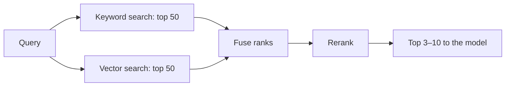

# Retrieval and ranking

## Learning objectives

After this chapter, you can:

- choose and version an embedding model;
- explain how approximate nearest-neighbor indexes trade recall for speed and memory;
- compare keyword and semantic search and combine them with reciprocal rank fusion;
- explain why a cross-encoder reranker improves precision; and
- improve the query side with rewriting, decomposition, and routing.

## Mental model

> Retrieve broadly and cheaply for recall, then rank narrowly and expensively for precision.



## Why this exists

No single retrieval method handles every query. Embeddings match meaning but blur exact identifiers; keyword search matches identifiers but misses paraphrases. A staged pipeline uses cheap methods to collect candidates and an accurate method to order a short list.

## Embedding models

- Compare candidates on the retrieval tasks of the [MTEB leaderboard](https://huggingface.co/spaces/mteb/leaderboard), then evaluate on your own data; public benchmarks rarely match a private domain.
- Consider domain fit (code, legal, multilingual), maximum input length, vector dimension (storage cost), latency, hosting, and licensing.
- Some models expect different prefixes for queries and documents. Follow the model's instructions; mismatched prefixes silently reduce quality.
- Models trained with Matryoshka representation learning allow truncating vectors to fewer dimensions with modest quality loss, reducing storage and search cost.
- **Version lock:** store the embedding model and version with every vector. Changing models means re-embedding everything; build the new index alongside the old one and switch when it passes evaluation.

## Vector indexes

Exact nearest-neighbor search over millions of vectors is slow, so production systems use approximate nearest-neighbor (ANN) indexes:

| Index | Idea | Trade-off |
| --- | --- | --- |
| Flat | Compare against every vector | Exact; practical only for small collections |
| HNSW | Multi-layer proximity graph | Fast with high recall; memory-intensive; a common default |
| IVF | Cluster vectors and search only the nearest clusters | Less memory; recall depends on how many clusters are probed |
| Quantization (product, scalar, binary) | Compress vectors | Much less memory with some recall loss; often re-scored with full vectors |
| Disk-based graphs | Store the graph on SSD | Very large collections |

Distance is usually cosine similarity; dot product gives the same ranking for normalized vectors.

As of October 2026, options include pgvector for teams already on PostgreSQL (useful when access-control joins must be transactional), OpenSearch and Elasticsearch (vector and keyword search together), and dedicated engines such as Qdrant, Weaviate, Milvus, Pinecone, LanceDB, and Vespa.

## Keyword versus semantic search

| | Keyword (BM25) | Semantic (dense vectors) |
| --- | --- | --- |
| Matches | Exact terms weighted by rarity | Meaning, paraphrases, synonyms |
| Strong on | Identifiers, error codes, product names, acronyms, rare jargon | Natural-language questions with different wording from the source |
| Weak on | Synonyms; no notion of meaning | Exact identifiers, negation, numbers |
| Explainability | High: you can see which terms matched | Low |

Example: the query `ORA-01555 snapshot too old` is answered well by keyword search because the code is rare and exact; embeddings may return general database-performance pages. The query "why is my report so slow" is answered better by semantic search.

Learned sparse retrieval (for example SPLADE) and late-interaction models (for example ColBERT) sit between the two and are worth knowing as alternatives.

## Hybrid retrieval with reciprocal rank fusion

Keyword and vector scores are on incompatible scales. Reciprocal rank fusion (RRF) combines result lists by rank, so no score normalization is needed:

```python
def reciprocal_rank_fusion(result_lists: list[list[str]], k: int = 60) -> list[str]:
    scores: dict[str, float] = {}
    for results in result_lists:  # each list holds document IDs, best first
        for rank, doc_id in enumerate(results):
            scores[doc_id] = scores.get(doc_id, 0.0) + 1.0 / (k + rank + 1)
    return sorted(scores, key=scores.get, reverse=True)
```

A document ranked well by both retrievers rises to the top; one found by only one retriever still survives. The constant `k` dampens the influence of the very top ranks; 60 is the value used in the original paper by Cormack, Clarke, and Büttcher (SIGIR 2009).

## Reranking

Embedding retrievers are *bi-encoders*: they encode the query and each document independently, which is fast but shallow. A *cross-encoder* reranker reads the query and a candidate together and scores relevance directly. It is far more accurate and far too slow for a whole corpus, which makes it ideal for re-ordering the top 50–150 candidates.

A typical pipeline retrieves 50–150 candidates, reranks them, and passes the top 3–10 to the model. Options include hosted rerankers, open-source cross-encoders, and a general LLM used as a reranker—flexible but more expensive.

## Improving the query

- **Rewriting:** turn a follow-up such as "what about the EU?" into a standalone query using conversation history.
- **Decomposition:** split a compound question into sub-questions and retrieve for each.
- **Hypothetical document embeddings (HyDE):** generate a hypothetical answer and embed it, which can land closer to relevant documents than the question does.
- **Routing:** choose the index or source—documentation, tickets, or a SQL tool—before retrieving.
- **Agentic retrieval:** let an agent decide when and what to search, and search again when results are weak (see [agents](../agents/agents-and-tool-use.md)).

## Common misconceptions

- **Misconception:** Semantic search supersedes keyword search.
  **Correction:** They fail on different queries. Hybrid retrieval is the safer default.
- **Misconception:** More retrieved chunks give the model more to work with.
  **Correction:** Extra loosely relevant chunks add cost and distraction. Rerank and keep a short list.

## Production considerations

- Measure each stage: recall of the candidate set, then precision after reranking.
- Watch filtered-search recall; some ANN engines degrade when a metadata filter is very selective.
- Budget reranker latency; it runs on every query.
- Cache embeddings by content hash and model version.

## Interview questions

1. Explain reciprocal rank fusion and why it avoids score normalization.
   <details><summary>Answer</summary>It scores each document by summing 1 / (k + rank) across result lists. Only ranks are used, so keyword and vector scores on different scales never need to be compared.</details>
2. What breaks when you change embedding models, and how do you migrate without downtime?
   <details><summary>Answer</summary>Old and new vectors are not comparable, so the whole corpus must be re-embedded. Build a second index in parallel, evaluate it, switch reads over, then retire the old index.</details>

## Exercises

1. On your own corpus, measure recall at 5 and 20 for keyword only, vector only, hybrid with RRF, and hybrid with reranking.
2. Collect five queries containing exact identifiers and five paraphrased questions. Record which retriever wins each.

## References

- Pinecone, [Rerankers and two-stage retrieval](https://www.pinecone.io/learn/series/rag/rerankers/)
- [MTEB leaderboard](https://huggingface.co/spaces/mteb/leaderboard)
- [pgvector](https://github.com/pgvector/pgvector)
- Cormack, Clarke, and Büttcher, *Reciprocal Rank Fusion Outperforms Condorcet and Individual Rank Learning Methods* (SIGIR 2009)
