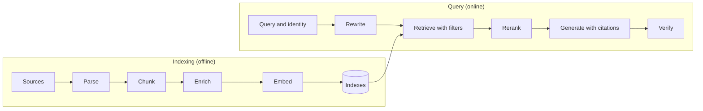

# Retrieval-augmented generation

Retrieval-augmented generation (RAG) supplies a model with evidence selected at request time. Use it when answers depend on a changing or private knowledge base and the application can identify supporting passages.

## Learning objectives

After this chapter, you can:

- decide between RAG, fine-tuning, and long-context prompting for a knowledge problem;
- describe the offline indexing pipeline and the online query pipeline;
- evaluate retrieval separately from generation; and
- name the common ways RAG systems fail.

## Mental model

> The model answers from what you put in front of it. RAG decides what that is.

## The retrieval loop

```text
ingest -> normalize -> chunk -> index -> retrieve -> rerank -> answer -> cite
```

The loop splits into two pipelines that run at different times:



The offline pipeline turns source documents into searchable units with metadata and permissions. The online pipeline uses the user's question *and identity* to select a small set of relevant, permitted passages, then asks the model to answer from them and cite them.

## Why this exists

A model's weights hold a lossy, dated snapshot of public text. Applications need answers from private, current, and permissioned data, with sources a user can check.

| Option | Good for | Poor for |
| --- | --- | --- |
| Fine-tuning | Style, format, task behavior | Injecting facts that change; citing sources; per-user permissions |
| Long-context prompting | Small, stable, single-audience corpora; with prompt caching it can be the simplest option | Large corpora; cost and latency per call; information lost in the middle; permissions |
| RAG | Large, changing, private, or permissioned knowledge with citations | Questions that need reasoning over the whole corpus at once |

Consider long-context prompting first when the corpus fits comfortably and has a single audience; move to RAG when size, freshness, or permissions require it.

## How it works

Each stage has its own chapter:

1. [Ingestion and chunking](ingestion-and-chunking.md): connectors, parsing, chunk boundaries, enrichment, and permission capture.
2. [Retrieval and ranking](retrieval-and-ranking.md): embedding models, vector indexes, keyword search, hybrid fusion, reranking, and query rewriting.
3. [Grounding and evaluation](grounding-and-evaluation.md): citation prompts, citation checks, abstention, and retrieval and answer metrics.
4. [Multi-tenant RAG](multi-tenant-rag.md): metadata filters, document access control, and tenant isolation.

## Evaluate retrieval and generation separately

Evaluate retrieval separately from generation. Useful retrieval measures include recall at *k*, ranking quality, freshness, and permission correctness. Then evaluate whether the generator uses the evidence faithfully and abstains when support is missing.

Separating the two tells you where to fix a wrong answer: if the right passage never reached the model, no prompt change will help.

## Common failures

Common failures include chunks without enough context, stale indexes, permission leaks, and confident answers assembled from irrelevant passages. Additional failures seen in practice:

- parsing that scrambles tables or multi-column layouts;
- deleted source documents that remain retrievable;
- exact identifiers, such as error codes, missed by embedding-only search; and
- too many loosely relevant chunks crowding out the relevant one.

## Common misconceptions

- **Misconception:** Wrong RAG answers are generation problems.
  **Correction:** Most begin as retrieval misses. Measure recall first.
- **Misconception:** A larger context window makes RAG unnecessary.
  **Correction:** It changes the threshold, not the trade-off. Cost, latency, mid-context degradation, and permissions still apply.
- **Misconception:** The prompt can enforce who sees which document.
  **Correction:** Access control belongs in the retrieval layer, before content reaches the model.

## Production considerations

- Version the embedding model, chunking strategy, and index alongside prompts.
- Monitor index freshness and deletion lag as data-quality signals.
- Log which chunks were retrieved and cited for every answer.
- Test permission correctness and cross-tenant isolation automatically.

## Interview questions

1. Your recall at 10 is 0.92 but users still report wrong answers. Where do you look next?
   <details><summary>Answer</summary>At generation and evidence use: whether the answer is faithful to the retrieved passages, whether the relevant passage is ranked where the model attends to it, whether conflicting or stale passages are present, and whether the model abstains when it should.</details>
2. When would you choose long-context prompting over RAG?
   <details><summary>Answer</summary>When the corpus is small enough to fit with headroom, changes rarely, has a single permission audience, and prompt caching makes repeated calls affordable.</details>

The multi-tenant design question is answered in [multi-tenant RAG](multi-tenant-rag.md#interview-questions).

## Exercises

1. Pick a knowledge problem at work and justify RAG, fine-tuning, or long context using the table above.
2. Build a small RAG over 50–200 of your own documents and log, for each answer, which chunks were retrieved and cited.

## References

- Lewis et al., [Retrieval-Augmented Generation for Knowledge-Intensive NLP Tasks (2020)](https://arxiv.org/abs/2005.11401)
- Anthropic, [Introducing Contextual Retrieval](https://www.anthropic.com/news/contextual-retrieval)
