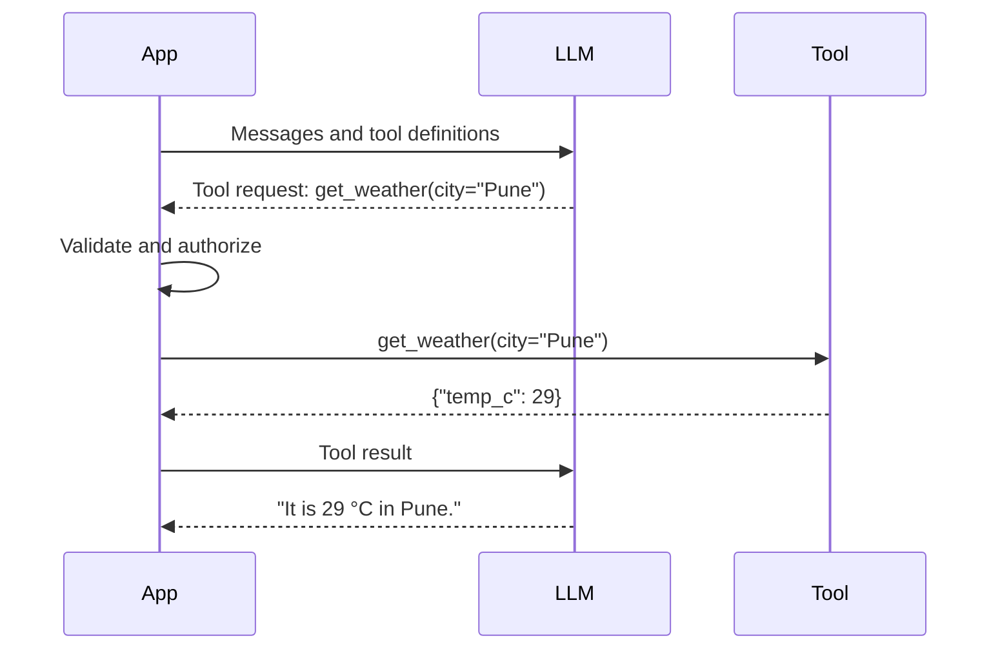

# Tool calling

## Learning objectives

After this chapter, you can:

- explain the request-execute-return cycle and why the model never executes anything itself;
- write tool definitions whose names, descriptions, and schemas guide correct use;
- keep identity and scope out of model-controlled arguments; and
- validate tool calls in layers: schema, semantics, authorization, risk, and budget.

## Mental model

> The model proposes a structured request; deterministic code decides whether and how to execute it.



The application sends tool definitions with the conversation. The model may answer directly or emit a structured tool request. The application validates and executes it, returns the result as new context, and calls the model again.

## Why this exists

[Prompt engineering](../prompting/prompt-engineering.md#push-deterministic-work-to-tools) establishes that exact, live, or consequential work belongs in deterministic code. Tool calling is the interface that lets a model *request* that work in a machine-readable form, so the application can check it before anything happens.

## How it works

### Tool definitions

The definition format is nearly identical across major providers: a name, a natural-language description, and a JSON Schema for the arguments.

```json
{
  "name": "search_orders",
  "description": "Search the current customer's orders. Use when the user asks about order status, delivery, or history. Returns at most 20 orders, newest first. Does not return payment details.",
  "input_schema": {
    "type": "object",
    "properties": {
      "status": {"type": "string", "enum": ["pending", "shipped", "delivered", "cancelled"]},
      "since": {"type": "string", "format": "date", "description": "ISO date, inclusive"}
    },
    "required": []
  }
}
```

Note what the schema omits: `customer_id`. The server injects it from the authenticated session. The model must never choose whose data a tool reads or writes.

### Designing tools for a model

The tool definition is part of the prompt, so the same care applies:

- **The description is the documentation the model reads.** State when to use the tool, when not to, what it returns, and its limits.
- **Prefer few, well-separated tools.** Overlapping tools are a leading cause of wrong-tool calls.
- **Design for the task, not the underlying API.** `schedule_meeting(attendees, duration)` is easier to use correctly than separate `list_calendars`, `get_free_busy`, and `create_event` tools.
- **Return concise, high-signal results.** Paginate, truncate, and select fields. Return human-readable names alongside opaque identifiers.
- **Return actionable errors.** "No orders after 2026-12-01; that date is in the future" lets the model self-correct; "400 Bad Request" does not.
- **Make mistakes hard.** Use enums, explicit units, and absolute identifiers instead of free text.

Anthropic's [Writing effective tools for agents](https://www.anthropic.com/engineering/writing-tools-for-agents) covers these practices in more depth.

### Validation layers

Never trust tool arguments. Check them in code, in this order:

| Layer | Question | Example |
| --- | --- | --- |
| Schema | Are types, required fields, enums, and formats valid? | JSON Schema or Pydantic; strict tool mode where available |
| Semantics | Do the values make business sense? | `amount > 0`; `end_date >= start_date`; refund ≤ refundable balance |
| Authorization | May *this user* perform *this action* on *this resource*? | Server-side policy check using the session identity |
| Risk | How reversible and how impactful is the action? | Read → execute; reversible write → log; irreversible → [human approval](../production/human-approval.md) |
| Budget | Is this call within quotas? | Per-run and per-tool limits (see [agents](../agents/agents-and-tool-use.md#budgets-and-termination)) |

## Minimal example

```python
from pydantic import BaseModel, Field


class RefundArgs(BaseModel):
    order_id: str = Field(pattern=r"^ord_[a-z0-9]{12}$")
    amount_cents: int = Field(gt=0, le=50_000)
    reason: str = Field(min_length=5, max_length=500)


def refund_tool(raw_args: dict, ctx) -> dict:
    args = RefundArgs.model_validate(raw_args)                       # schema and bounds
    order = ctx.orders.get(args.order_id, customer_id=ctx.customer_id)  # scope comes from the session
    refundable = order.total_cents - order.refunded_cents
    if args.amount_cents > refundable:                               # business rule
        return {"error": f"Refund exceeds refundable balance of {refundable} cents"}
    return ctx.payments.refund(order, args.amount_cents, idempotency_key=ctx.step_key("refund"))
```

Return validation failures to the model as tool results so it can correct itself, but cap the number of correction attempts. The idempotency key is explained in [checkpointing and recovery](../memory/checkpointing-and-recovery.md).

## Model Context Protocol

The [Model Context Protocol (MCP)](https://modelcontextprotocol.io/) standardizes how tools, resources, and prompts are exposed to models, so one tool server can serve many clients. It changes how tools are packaged and discovered, not the validation and authorization responsibilities described here. See the [MCP section](../mcp/index.md).

## Common misconceptions

- **Misconception:** The model calls the tool.
  **Correction:** The model emits a request. Application code executes it—or refuses.
- **Misconception:** A well-written description is enough to prevent misuse.
  **Correction:** Descriptions improve selection; validation and authorization in code enforce correctness.
- **Misconception:** More tools make an agent more capable.
  **Correction:** Beyond a small set, overlap increases wrong-tool calls. Route to specialized agents or combine tools instead.

## Production considerations

- Inject tenant, user, and other scope identifiers server-side; overwrite or reject any model-supplied values.
- Separate read tools from write tools and give each the least privilege it needs.
- Log every tool request, validation outcome, and result with the run and step identifiers.
- Measure tool-selection accuracy and argument accuracy in evaluation (see [evaluation](../production/evaluation.md)).
- Treat tool output as untrusted data when it returns to the model (see [security](../production/security.md)).

## Interview questions

1. Why should `customer_id` not be a tool argument the model fills?
   <details><summary>Answer</summary>Because the model's output can be influenced by user input and injected content. Scope must come from the authenticated session so the model cannot read or modify another customer's data.</details>
2. A model keeps choosing `search_tickets` when it should choose `search_orders`. What do you change first?
   <details><summary>Answer</summary>The tool interface: clearer, non-overlapping names and descriptions with "use when / do not use when" guidance, or fewer tools exposed for that task. Then measure tool-selection accuracy on an evaluation set.</details>

## Exercises

1. Write definitions for three tools in a domain you know, including when-not-to-use guidance. Ask a colleague to predict which tool fits ten requests using only the descriptions.
2. Implement the five validation layers for one write tool and test each rejection path.
3. Rewrite three opaque error messages from an existing API as actionable tool errors.

## References

- Anthropic, [Tool use overview](https://docs.claude.com/en/docs/agents-and-tools/tool-use/overview)
- OpenAI, [Function calling](https://platform.openai.com/docs/guides/function-calling)
- Anthropic, [Writing effective tools for agents](https://www.anthropic.com/engineering/writing-tools-for-agents)
- [Model Context Protocol](https://modelcontextprotocol.io/)
