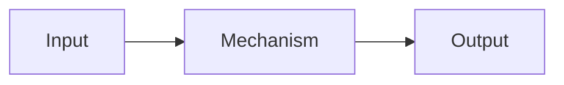

# Chapter title

## Learning objectives

After this chapter, you can:

- Explain ...
- Compare ...
- Implement ...

## Mental model

State the shortest accurate intuition before adding detail.

## Why this exists

Start with the problem this mechanism solves.

## How it works

Build the explanation from first principles.

## Minimal example

Link a runnable example from `examples/` when appropriate.

## Common misconceptions

- **Misconception:** ...
  **Correction:** ...

## Production considerations

Discuss quality, reliability, latency, cost, security, privacy, and observability where relevant.

## Interview questions

1. Question?
   

Answer
Concise interview-ready answer.

## Exercises

1. A conceptual check.
2. A small implementation or design exercise.

## References

- Add primary sources with descriptive links.
