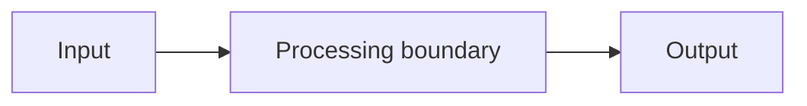

# Diagram title

## Purpose

State the single relationship, process, or boundary this diagram should make easier to understand.

## Diagram

## Reading guide

Explain the important nodes, arrows, boundaries, and assumptions. A diagram should not require readers to infer its intended lesson.

## Source and maintenance

- Owning chapter: `docs/path/to/chapter.md`
- Last reviewed: YYYY-MM-DD
- Update triggers: list architectural or terminology changes that require this diagram to be reviewed.
