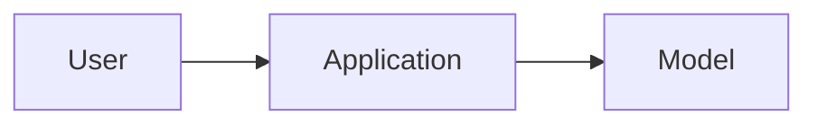

# Project title

## Learning objectives

After completing this project, you can:

- Design ...
- Implement ...
- Evaluate ...

## Prerequisites

- Link the required handbook chapters.
- List the required runtime and tools.

## Problem statement

Describe the user problem, constraints, and explicit non-goals.

## Architecture

Explain why each component exists and which simpler alternatives were considered.

## Milestones

1. Establish a deterministic baseline.
2. Implement the smallest end-to-end path.
3. Add evaluation and representative fixtures.
4. Add reliability, security, and observability controls.
5. Document results and remaining limitations.

## Run locally

Document setup, configuration, commands, and expected output without requiring production credentials.

## Evaluation

Define the dataset, quality thresholds, latency and cost measures, and regression process.

## Production considerations

Cover failure modes, permissions, data handling, scaling, monitoring, rollback, and operational ownership.

## Exercises

List extensions that require the reader to make and defend engineering trade-offs.

## References

- Add primary references used by the project.

